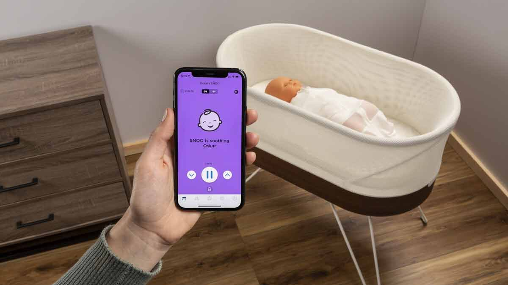
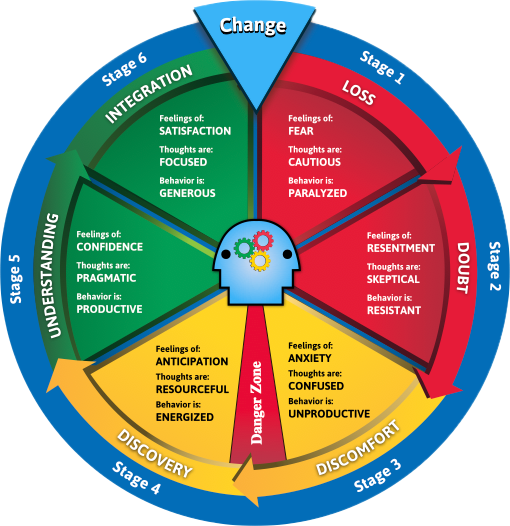
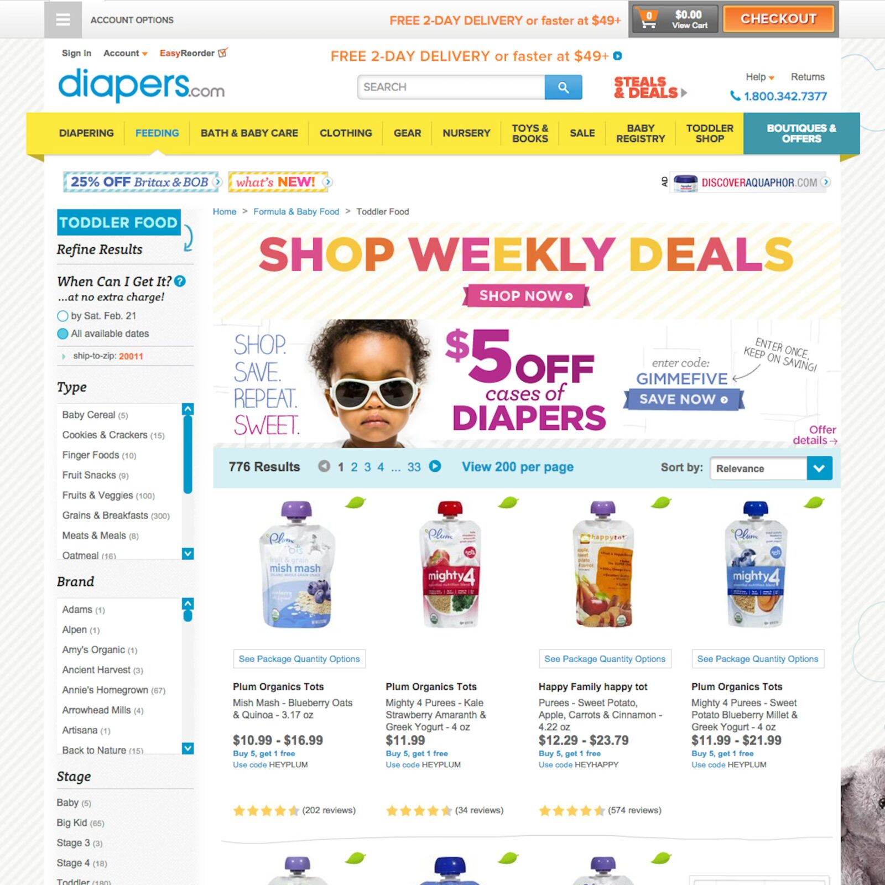
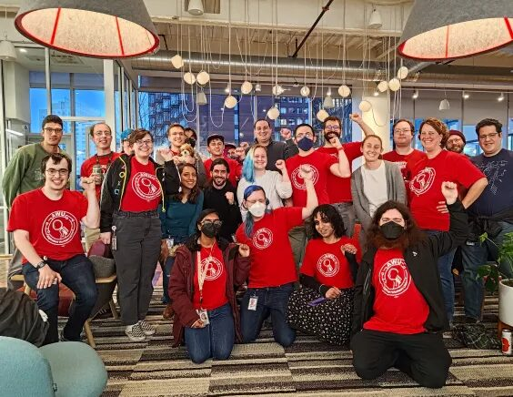
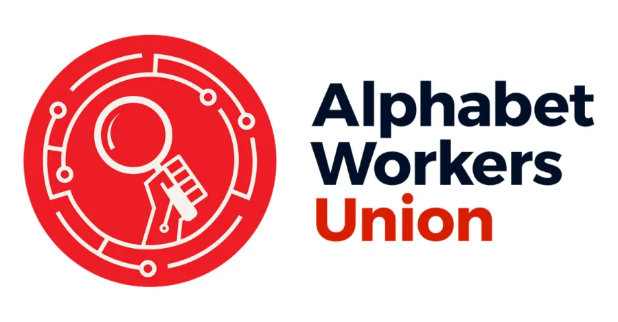

---
#
# Not a weekly deck: sync_slide_index.py only lists weekN files, so this one
# stays off /slides/. It is linked from read-a-book/book-presentation.md.
format:
  revealjs:
    theme: [theme/blue-line.scss, theme/blue-line-dark.scss]
---

# Book Presentation Samples {.title-slide}

Book: Enshittification\
Author: Cory Doctorow\
Presenter: Jack Bandy

# “Good” Version {.title-slide .section-header}

---

## Cory Doctorow (About the Author)

:::: columns
::: {.column width="58%"}
- Publishes fiction and non-fiction
- Advocate for digital rights
- Worked at Electronic Frontier Foundation
- Themes: user autonomy, corporate power
:::

::: {.column width="40%"}
{fig-alt="Cory Doctorow at his desk in front of floor-to-ceiling bookshelves crowded with books and toys" style="max-height:420px;"}
:::
::::

---

## Why I Chose the Book

:::: columns
::: {.column width="58%"}
- Fun title
- I like other stuff by Doctorow
- Curious about the theory / framework
- Less jargony than other books
- Concrete examples
:::

::: {.column width="40%"}
{fig-alt="Cover of Enshittification by Cory Doctorow: white type on black above a poop emoji with grawlix symbols" style="max-height:400px;"}
:::
::::

---

## Questions I had before reading the book

- What are the key ingredients for enshittification?
- What are the details of this theory?
- What is the supporting evidence for this theory?
- How can companies reverse and/or slow enshittification?
- Why do people stay on crappy apps?
- What are the best next steps?

---

## Interesting things I learned

- Amazon spent \$200 million to drive Diapers.com out of business
- Interoperability can help prevent enshittification
  - Companies often lock things intentionally
  - “Turing-complete universal von Neumann machines”
- Network effects are a significant obstacle for people to quit or switch apps
- Doctorow does not think enshittification is inevitable
- "The Death of Competition Kills Regulation, Too"
- Rent-seeking is not the same as profit-seeking
- Goodhart’s law

---

## Specific Examples

:::: columns
::: {.column width="55%"}
- The SNOO is \$1,695 up front and then \$20 a month
- "We don't care. We don't have to. We're the phone company."
- "We don't care. We don't have to. We're Google."
- Counter-twiddling
  - Para
  - tuyul
:::

::: {.column width="43%"}
{fig-alt="A hand holding a phone running the SNOO app beside the SNOO smart bassinet with a baby inside" style="max-height:300px;"}
:::
::::

---

## Have you seen any examples?

- Apps that get ruined after being bought out?
- Unnecessary or surprising subscriptions?
- Apps that should not be apps?
- Apps that “bait and switch”?
- Other crappy experiences?

---

## Questions I had after reading the book

- Which regulatory changes are realistic in the near future?
- How will EU legislation play out?
- Will companies ever really prioritize the public good over shareholders?
- How do big companies get away with all this?

---

## Actions

:::: columns
::: {.column width="60%"}
- Use open-source alternatives whenever possible
- Support artists and creators as directly as possible
- Support regulation
- Vote with your wallet
- Be mindful of your digital footprint
:::

::: {.column width="38%"}
{fig-alt="The Change Cycle wheel: six colored stages (loss, doubt, discomfort, discovery, understanding, integration) around a central head, with the feelings, thoughts, and behaviors of each stage" style="max-height:400px;"}
:::
::::

---

## I recommend this book if you are…

- annoyed by social media and other apps
- care about privacy and digital rights
- wonder about planned obsolescence
- curious about how the internet initially formed and grew
- looking for action items to resist tech monopolies

# “Better” Version {.title-slide .section-header}

# If Microsoft offered to buy your startup… {.title-slide}

---

## Doctorow on Microsoft {.quote-slide .story-slide}

:::: {.columns style="width:100%;"}
::: {.column width="64%"}
> “The investors told me I was lucky, that I would get a great job at Microsoft out of this deal, even if I didn’t make any money from the sale. So I quit the company and went to work for EFF instead. The deal fell through, the investors got nothing, and 23 years later, I’m still at EFF.
:::

::: {.column width="33%"}
{fig-alt="Cory Doctorow at his desk in front of crowded bookshelves, cropped to the right half of the photo" style="max-height:560px;"}
:::
::::

---

## Cory Doctorow

:::: columns
::: {.column width="45%"}
- Author of 15 novels and 6 nonfiction books
- Most of career at Electronic Frontier Foundation (EFF)
- His work has converged around one word…
:::

::: {.column width="53%"}
{fig-alt="Cory Doctorow at his desk in front of floor-to-ceiling bookshelves crowded with books and toys" style="max-height:440px;"}
:::
::::

---

## {.photo-only data-menu-title="Enshittification"}

{fig-alt="Cover of Enshittification: Why Everything Suddenly Got Worse and What to Do About It by Cory Doctorow: white type on black above a poop emoji with grawlix symbols" style="display:block;margin:0 auto;max-height:588px;"}

---

## Enshittification: How [diapers.com](http://diapers.com) went out of business

:::: columns
::: {.column width="48%"}
{fig-alt="Screenshot of the Diapers.com storefront advertising weekly deals and five dollars off cases of diapers" style="max-height:400px;"}
:::

::: {.column width="48%"}
{fig-alt="The Amazon logo with its smile arrow" style="max-height:400px;"}
:::
::::

---

## Enshittification: guess how much for a snoo!

{fig-alt="A hand holding a phone running the SNOO app beside the SNOO smart bassinet with a baby inside" style="display:block;margin:0 auto;max-height:420px;"}

::: notes
The SNOO is \$1,695 up front and then \$20 a month
:::

# What do we do? {.title-slide .section-header}

---

## Solution 1: Competition

:::: columns
::: {.column width="48%"}
{fig-alt="Top half of an infographic, 'The 7 Biggest US Airlines by passengers carried, 2018': Spirit, JetBlue, Alaska, and United, each with a plane in its livery" style="max-height:420px;"}
:::

::: {.column width="48%"}
{fig-alt="Bottom half of the same infographic: Southwest, Delta, and American, each with a plane in its livery" style="max-height:420px;"}
:::
::::

---

## Solution 2: Real Regulation

:::: columns
::: {.column width="62%"}
{fig-alt="A padlock inside the ring of EU stars beside the words General Data Protection Regulation, over blue binary code" style="max-height:400px;"}
:::

::: {.column width="34%"}
{fig-alt="Bill, the rolled-up legislation cartoon character from Schoolhouse Rock, waving and wearing a BILL button" style="max-height:420px;"}
:::
::::

---

## Solution 3: Interoperability

:::: columns
::: {.column width="48%"}
{fig-alt="Close-up of a USB-C plug with gold contacts" style="max-height:400px;"}
:::

::: {.column width="48%"}
{fig-alt="A USB-C cable plugged into the edge of a laptop" style="max-height:190px;"}

{fig-alt="A USB-C port with the SuperSpeed USB logo beside it" style="max-height:190px;"}
:::
::::

---

## Solution 4: Worker Power

:::: columns
::: {.column width="52%"}
{fig-alt="A crowd of Alphabet Workers Union members in matching red union shirts, fists raised, in an office" style="max-height:420px;"}
:::

::: {.column width="44%"}
{fig-alt="Red graphic reading First Union Contract for Alphabet Workers Union-CWA, with members holding up a signed contract" style="max-height:220px;"}

{fig-alt="Alphabet Workers Union logo: a red circle with a magnifying glass and a raised fist" style="max-height:150px;"}
:::
::::

# (end of sample) {.title-slide}

---

## Good vs. Better

# Additional Presentation Tips {.title-slide .section-header}

# a b c d e f g {.title-slide .section-header}

::: notes
Things to change in your voice:

- Volume
- Pace
- Tone
- pitch
- Pause
- stress
- Inflection
:::

# A B C D E F G {.title-slide .section-header}

::: notes
Things to change in your voice:

- Volume
- Pace
- Tone
- pitch
- Pause
- stress
- Inflection
:::

# a b c d&nbsp;&nbsp;&nbsp;&nbsp;**E**&nbsp;&nbsp;&nbsp;&nbsp;f g {.title-slide .section-header}

::: notes
Things to change in your voice:

- Volume
- Pace
- Tone
- pitch
- Pause
- stress
- Inflection
:::

# A b c. D e f g? {.title-slide .section-header}

::: notes
Things to change in your voice:

- Volume
- Pace
- Tone
- pitch
- Pause
- stress
- Inflection
:::

# a b…&nbsp;&nbsp;&nbsp;&nbsp;C!&nbsp;&nbsp;&nbsp;&nbsp;&nbsp;d e f g {.title-slide .section-header}

::: notes
Things to change in your voice:

- Volume
- Pace
- Tone
- pitch
- Pause
- stress
- Inflection
:::

# References & Credits {.sources}

1. GitHub source: <https://github.com/jackbandy/ethical-issues-in-computing-uic/blob/main/docs/slides/example-book-presentation.md>.
2. Cory Doctorow, [*Enshittification: Why Everything Suddenly Got Worse and What to Do About It*](https://bookshop.org/p/books/enshittification-why-everything-suddenly-got-worse-and-what-to-do-about-it-cory-doctorow/d3f8483b158906ce?ean=9780374619329) (Farrar, Straus and Giroux), ISBN 9780374619329; cover art from the publisher.
3. Doctorow in his office: [Jonathan Worth](https://commons.wikimedia.org/wiki/File:Cory_Doctorow_portrait_by_Jonathan_Worth_1.jpg), 2009, via Wikimedia Commons, CC BY 2.0 (cropped on the quote slide).
4. Doctorow quote, "The investors told me I was lucky…": Jordan Yerman, ["Interview with Cory Doctorow – Journalist, Activist, and Author"](https://www.cloudfest.com/blog/interview-with-journalist-author-cory-doctorow), CloudFest, March 13, 2025.
5. SNOO photo: TBD. Pricing: ["Should You Buy a Snoo Smart Bassinet for Your Newborn?"](https://www.consumerreports.org/babies-kids/bassinets/should-you-buy-a-snoo-smart-bassinet-for-your-newborn-a9587255697/), Consumer Reports.
6. Change Cycle wheel ("Actions"): stages from Ann Salerno and Lillie Brock, [*The Change Cycle*](https://www.oreilly.com/library/view/the-change-cycle/9781576757826/) (Berrett-Koehler); image TBD.
7. Diapers.com screenshot and Amazon logo photo: TBD (Amazon logo is a trademark of Amazon.com, Inc.).
8. Solution 1, "The 7 Biggest US Airlines" infographic: TBD.
9. Solution 2, GDPR graphic: TBD. Bill, from *Schoolhouse Rock!* ["I'm Just a Bill"](https://en.wikipedia.org/wiki/I%27m_Just_a_Bill) (1976); drawing TBD.
10. Solution 3, USB-C photos: TBD.
11. Solution 4, logo, contract graphic, and member photo: [Alphabet Workers Union-CWA](https://www.alphabetworkersunion.org/); source posts TBD.
