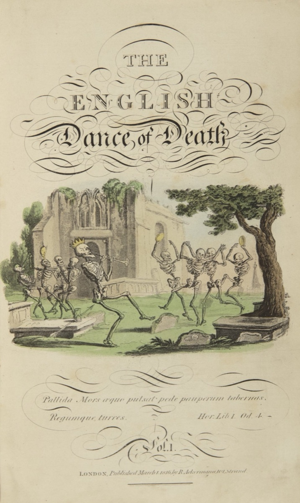
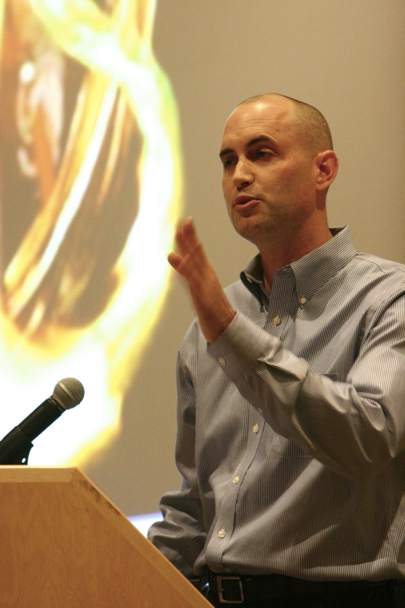
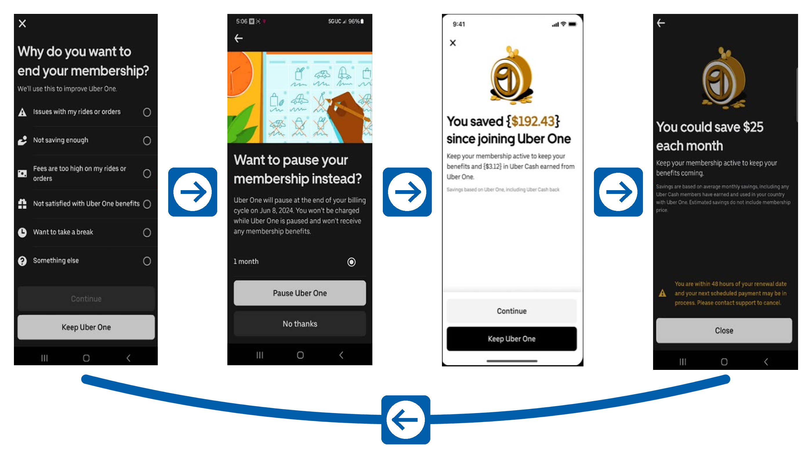
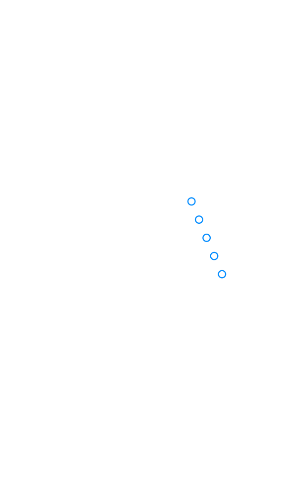
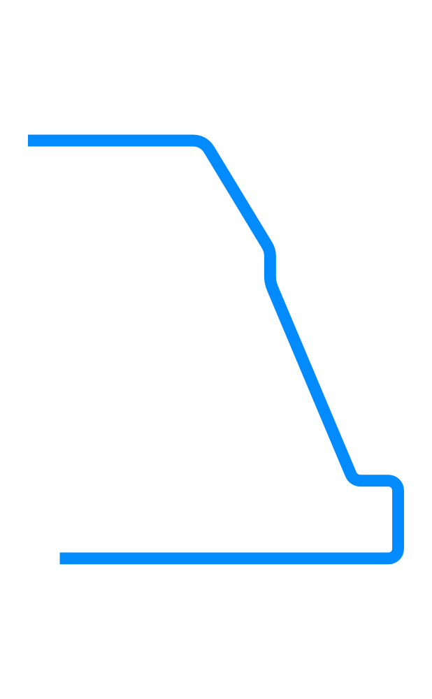

# Speculative Fiction Day {.title-slide data-menu-title="Week 10, Day 1"}

CS 377, Week 10, Day 1 🟦 California 🟦

---

# Speculative Fiction Day {.title-slide .photo-title data-state="photo-title" background-image="../assets/blue-line-stops-better/stop23-california-station-house.jpg" background-size="cover" data-menu-title="Week 10, Day 1"}

CS 377, Week 10, Day 1 🟦 California 🟦

<!-- image source: AmyLExtraordinaire, CC BY-SA 4.0, https://commons.wikimedia.org/wiki/File:California_Station_on_the_CTA_%27L%27_Blue_Line.png -->

---

## {.photo-only data-state="photo-only" background-image="../assets/blue-line-stops-better/stop23-california-station-house.jpg" background-size="cover"}

---

## Agenda for Today

:::: columns
::: {.column width="55%"}
- Free write
- Group exercise: pitch your story
- Vote on stories
:::

::: {.column width="40%"}

:::
::::

---

# Free Write {.title-slide .section-header}

---

## Free Write {.embed-slide}

::: {.embed-layout .golden-columns}
::: {.embed-copy}
- Turn off phones, laptops, etc.
- Get out your notebooks!
- Write whatever!
- If you need a prompt:
	- Have you encountered any absurd dilemmas recently?
	- Could be in your own life, friend, family, fiction...
:::

::: {.embed-frame}
<iframe
  src="../timer/index.html"
  title="CTA-style countdown timer"
  loading="lazy"
  data-external="1">
</iframe>
:::
:::

---

# Pitch Your Story {.title-slide .section-header}

Exercise and promo slide template adapted from Casey Fiesler's ["Black Mirror Writers Room"](https://www.internetruleslab.com/black-mirror-writers-room) (CC BY 4.0), expanded with Shamika Klassen

---

## Group Exercise: Pitch Your Story {.embed-slide}

::: {.embed-layout .golden-columns}
::: {.embed-copy}
- See handout
- Let me know your title once you have it
- Take a promo picture and make your promo slide:
  - 12:30pm section: [Fiction - 12:30pm](https://crypt.unredacted.org/presentation/#/2/presentation/edit/gEhcDUYeaSIL6bgBaw-e4CnV/p/)
  - 2:00pm section: [Fiction - 2:00pm](https://crypt.unredacted.org/presentation/#/2/presentation/edit/GlPyl6rw9heGg1GW+m+Y6405/p/)
- Turn in one worksheet per group
:::

::: {.embed-frame}
<iframe
  src="../timer/index.html"
  title="CTA-style countdown timer"
  loading="lazy"
  data-external="1">
</iframe>
:::
:::

---

# Vote on Stories {.title-slide .section-header}

---

## Vote on Stories

- Each group pitches its episode
- 12:30pm section: [Fiction - 12:30pm](https://crypt.unredacted.org/presentation/#/2/presentation/edit/gEhcDUYeaSIL6bgBaw-e4CnV/p/)
- 2:00pm section: [Fiction - 2:00pm](https://crypt.unredacted.org/presentation/#/2/presentation/edit/GlPyl6rw9heGg1GW+m+Y6405/p/)

---

## Results are in...

---

## That's all for today!

See you Wednesday!

---

# Nudges and Dark Design Patterns {.title-slide data-menu-title="Week 10, Day 2"}

CS 377, Week 10, Day 2 🟦 Logan Square 🟦

---

# Nudges and Dark Design Patterns {.title-slide .photo-title data-state="photo-title" background-image="../assets/blue-line-stops-better/stop24-logan-square-canopy-rendering.jpg" background-size="cover" data-menu-title="Week 10, Day 2"}

CS 377, Week 10, Day 2 🟦 Logan Square 🟦

<!-- image source: Image via CDOT, Jacobs Engineering -->

---

## {.photo-only data-state="photo-only" background-image="../assets/blue-line-stops-better/stop24-logan-square-canopy-rendering.jpg" background-size="cover"}

---

## Agenda for Today

:::: columns
::: {.column width="55%"}
- Administrivia
  - Asynchronous class Monday
  - Presentations start Wednesday
- Seat shuffle
- How to pay attention
- How to build a habit
- How to give a presentation
:::

::: {.column width="40%"}

:::
::::

---

## 🔀 Seat Shuffle

:::: columns
::: {.column width="40%"}
- Shuffle seats!
- Enter a seed and shuffle

[Open in a new tab](https://doethics.fun/chairs/)
:::

::: {.column width="55%"}
{fig-alt="Rows of numbered green seats at Wrigley Field"}
:::
::::

---

## Ethics in the News {.news-cards}

:::: columns
::: {.column width="54%"}
- The lawsuit alleges ChatGPT drafted taper schedules "that would take her dose to zero within weeks"
- also told her physician recommendations "essentially stem from risk aversion"
- family points to OpenAI's Model Spec
	- e.g. copyrighted text versus medical advice
:::

::: {.column width="42%"}

AI

<a href="https://techcrunch.com/2026/10/27/parents-sue-openai-alleging-gpt-4o-coached-their-daughter-off-seizure-medication/">Parents sue OpenAI, alleging GPT-4o coached their daughter off seizure medication</a>

A family is suing OpenAI, saying ChatGPT coached their daughter to quietly taper off her seizure medication and keep it from her doctors before she died in February.

Image Credits: Jaque Silva/NurPhoto / Getty Images

By Aditya Mehta · October 27, 2026 · <a href="https://techcrunch.com/2026/10/27/parents-sue-openai-alleging-gpt-4o-coached-their-daughter-off-seizure-medication/">techcrunch.com</a>

:::
::::

---

# How to Pay Attention {.title-slide .section-header}

---

## How to Pay Attention

::: {.source-top}
[Kaitlyn Tiffany, "A 'Radical' Approach to Reclaiming Your Attention," *The Atlantic*, 2024](https://www.theatlantic.com/technology/archive/2024/12/strother-school-radical-attention/680830/); [Strother School of Radical Attention, "The Attention SCORE"](https://www.schoolofattention.org/scores)
:::

:::: columns
::: {.column width="55%"}
- "Our attention is born free, but is, increasingly, everywhere in chains."
- Attention SCORE: "Social Choreography for Observation, Reflection, and Enaction"
	- e.g. look at a painting (2 min), look away (2 min), look again (2 min)
- "Wrong Translations" (Simone Weil): the object, then your attention, then the object again ("What is here ... now?")
:::

::: {.column width="40%"}
{fig-alt="Thomas Rowlandson's 1816 frontispiece to The English Dance of Death: skeletons dancing around a figure of Death"}

::: {.caption}
Thomas Rowlandson, frontispiece to *The English Dance of Death* (1816), [public domain](https://commons.wikimedia.org/wiki/File:Rowlandson-english-dance-of-death.jpg)
:::
:::
::::

---

## SCORE: The Skeleton Dance (1929)

1. Watch: [*The Skeleton Dance*](https://archive.org/details/the-skeleton-dance_1929) (Walt Disney, 1929), Internet Archive
2. Think: write about it on your own
3. Talk: discuss in groups
4. Watch it again
5. Discuss it again!

---

## SCORE, Step 2: Think {.embed-slide}

::: {.embed-layout .golden-columns}
::: {.embed-copy}
- On your own, write in your notebook:
	- What happened while you watched?
	- Where did your attention go?
	- Did you miss anything?
	- "What is here ... now?"
:::

::: {.embed-frame}
<iframe
  src="../timer/index.html"
  title="CTA-style countdown timer"
  loading="lazy"
  data-external="1">
</iframe>
:::
:::

---

## SCORE, Step 3: Talk {.embed-slide}

::: {.embed-layout .golden-columns}
::: {.embed-copy}
- Share at your tables?
	- What happened while you watched?
	- Where did your attention go?
	- Did you miss anything?
	- "What is here ... now?"
:::

::: {.embed-frame}
<iframe
  src="../timer/index.html"
  title="CTA-style countdown timer"
  loading="lazy"
  data-external="1">
</iframe>
:::
:::

---

## SCORE, Step 4: Watch Again

- Watch: [*The Skeleton Dance*](https://archive.org/details/the-skeleton-dance_1929) (Walt Disney, 1929), Internet Archive
- What is different the second time?

---

# How to Build a Habit {.title-slide .section-header}

---

## BJ Fogg

:::: columns
::: {.column width="58%"}
- "Persuasive Technology Lab" at Stanford
- Taught in the 2000s
- "Working in teams of three, the 75 students created apps that collectively had 16 million users in just 10 weeks."
- Many apps designed for Facebook
:::

::: {.column .portrait-solo width="38%"}

::: {.caption}
BJ Fogg. Photo: kris krüg, 2005, [CC BY 2.0](https://commons.wikimedia.org/wiki/File:B_J_Fogg_1.jpg)
:::
:::
::::

---

## "Persuasive Design"

:::: columns
::: {.column width="50%"}
- Also referred to as "Captology" (Computers as Persuasive Technology)
- More broadly about behavior change
- "It's not complicated, it's systematic"
- Three key ingredients for behavior change:
  - **Motivation**
  - **Ability**
  - **Trigger / Call to Action** ("Now!")
:::

::: {.column width="46%"}
{fig-alt="Four Uber One cancellation screens in a row: a survey asking why you want to end your membership, an offer to pause instead, a screen saying you saved $192.43, and a screen saying you could save $25 each month with only a Close button. Arrows run left to right, and a loop arrow runs from the last screen back to the first."}

::: {.caption}
Uber One cancellation loop, from the FTC's complaint, [*FTC v. Uber Technologies*](https://www.ftc.gov/system/files/ftc_gov/pdf/uberonecomplaint.pdf) (2025), Ex. 20; arrows redrawn
:::
:::
::::

---

## Dot, Span, Path

:::: columns
::: {.column width="55%"}
- Dot: do it once!

::: {.fragment fragment-index="1"}
- Span: repeat a few times
:::

::: {.fragment fragment-index="2"}
- Path: habitualized
:::
:::

::: {.column width="40%"}
::: {.r-stack}
{fig-alt="A single Blue Line station dot at Logan Square" style="max-height:560px;"}

{.fragment fragment-index="1" fig-alt="Five Blue Line station dots in a row, starting at Logan Square" style="max-height:560px;"}

{.fragment fragment-index="2" fig-alt="The full Blue Line route as one smooth line" style="max-height:560px;"}
:::
:::
::::

---

## "Nudging" toward Habits and Virtues

:::: columns
::: {.column width="58%"}
- Positive habit-building can also be done persuasively
- "Humane design," "value-centered design," etc.
- Also called "nudging"
:::

::: {.column width="38%"}
{fig-alt="The wood-railed grand stair rising through the five-story atrium of UIC's Computer Design, Research, and Learning Center, with people walking across the atrium floor"}

::: {.caption}
The atrium stair in UIC's Computer Design, Research, and Learning Center (LMN Architects with Booth Hansen)
:::
:::
::::

---

# How to Give a Presentation {.title-slide .section-header}

---

## Demo Book Presentation

- [Example book presentation](example-book-presentation.html)

---

## What Makes a Strong Book Presentation?

- **Clear thesis**: what is the book's central argument?
- **Specific evidence**: concrete examples and quotes
- **Ethical analysis**: which theory or theories help explain the stakes?
- **Personal reflection**: what did you learn? What changed your thinking?
- **Engagement**: how will you get the class involved?

---

## That's all for today!

See you Wednesday!

---

# Appendix: Leftover Slides {.title-slide .section-header}

---

# Nudges and Dark Design Patterns {.title-slide .section-header .no-index}

<!-- NOTICE: Draft from old-slides/pdf-versions/21 Nudges.pdf and 20 Dark Patterns.pdf. Review and edit before use. -->

---

## Agenda for Today

:::: columns
::: {.column width="55%"}
- Administrivia
  - More grades incoming!
  - Presentations start Wednesday
  - Canvas updates
- Book check-in
- Mini-lecture: Nudges and Dark Design Patterns
- Outdoor activity: find a nudge on campus
- Presentation tips
:::

::: {.column width="40%"}

:::
::::

---

## 🔀 Seat Shuffle

<!-- image: room diagram — lectern "0", tables 1–8, projector screens, door -->
- TODO: add image — *room diagram — lectern "0", tables 1–8, projector screens, door*

---

## Table Discussion: Book Check-in

- How much have you read? What helps you read? (Where? When? What else?)
- How are you taking notes / keeping track of what you're learning?
- What are your ideas for your presentation?
- What does your reading schedule look like for the next few weeks?
- (If time) What ideas do you have for your personal ethics commitments?

---

# Dark Design Patterns {.title-slide .section-header .no-index}

---

## Mini-Lecture: "Nudging" and Dark Design Patterns

---

## Dolls and Puppets

<!-- image: photo of puppet/doll — Study Breaks Magazine, Danielle Kuzel — connecting to the earlier rag-doll exercise -->
- TODO: add image — *photo of puppet/doll — Study Breaks Magazine, Danielle Kuzel — connecting to the earlier rag-doll exercise*

---

## Poll: Screen Time

- "I would like to spend less time on my phone and more time doing other activities"
  - Strong disagree / Disagree / Not sure / Agree / Strong agree

---

## Poll: Average Daily Screen Time

- What is your average daily screen time?
  - iOS: Settings → Screen Time → See All App & Website Activity
  - Android: Settings → Digital Wellbeing & parental controls → Dashboard
  - Answer in minutes (e.g. 1hr = 60 mins)

---

## Common Examples of Dark/Deceptive Design

::: {.incremental}
- False urgency ("Only 2 left!")
- Infinite scroll (no natural stopping point)
- Variable reward in notifications (slot machine design)
- Notifications as triggers (interruption as mechanism)
- Preselected defaults (opt-out instead of opt-in)
- "Confirmation shaming" ("No thanks, I don't want to save money")
- Visual interference (making the "no" option hard to find)
:::

*See [darkpatterns.uxp2.com](https://darkpatterns.uxp2.com/)*

---

# Nudging {.title-slide .section-header .no-index}

---

## A Nudge Defined {.quote-slide}

> "A nudge is an intervention that maintains freedom of choice but steers people
> in a particular direction."
>
> — Cass Sunstein

---

## Nudging Examples

Basketball-style cues to encourage recycling

<!-- image: basketball hoop over recycling bin -->
- TODO: add image — *basketball hoop over recycling bin*

---

## Nudging Examples

<!-- image: bike-friendly speed bump on the Alameda Ridge (Jonathan Maus / BikePortland) -->
- TODO: add image — *bike-friendly speed bump on the Alameda Ridge (Jonathan Maus / BikePortland)*

---

## Nudging Examples

Staircase of the James B. Hunt Library, North Carolina State University (Snøhetta, 2013)

<!-- image: Hunt Library staircase — designed to encourage stair use (LMN Architects / Booth Hansen, Architect of Record) -->
- TODO: add image — *Hunt Library staircase — designed to encourage stair use (LMN Architects / Booth Hansen, Architect of Record)*

---

## Nudges for Behavior Change

<!-- image: summary diagram of nudges for behavior change -->
- TODO: add image — *summary diagram of nudges for behavior change*

---

## Other Nudges

- Doors or barriers guiding walking paths
- Grocery store layouts (prominence of produce)
- Shopping mall layouts (encourage wandering)
- Seating arrangements that encourage or discourage certain behaviors
- Road design to slow down drivers ("traffic calming")

---

## Group Activity: Find a Nudge on Campus

- Find a design nudge (or hook) somewhere on campus
- Take a picture of the nudge or hook in action, using group members as actors
- Email it to Dr. Bandy (jxb@uic.edu)
- Come back in 15 minutes to share
- **Signage does not count!**

---

## Your Examples

<!-- image: group photos — placeholders for student submissions, organized by section (12:30, 2:00, 3:30) and group number -->
- TODO: add image — *group photos — placeholders for student submissions, organized by section (12:30, 2:00, 3:30) and group number*

---

## Table Discussion: Hooks and Nudges

- Explore examples at [consciouspatterns.in](https://www.consciouspatterns.in/ethical-gallery)
- What's your experience with hooks and nudges?
- Which apps/products have hooks that you notice?
- Which apps/products have more virtue-building "nudges"?
- How would you approach this as a developer?
- Have you developed anything with hooks or nudges?

---

# Case Study: Age Verification {.title-slide .section-header .no-index}

---

## Case Study: ChatGPT Age Verification

<!-- image: ChatGPT age verification flow using Yoti -->
- TODO: add image — *ChatGPT age verification flow using Yoti*

---

## Discussion: What Could Go Wrong?

<!-- image: age verification discussion slide — what failure modes exist? -->
- TODO: add image — *age verification discussion slide — what failure modes exist?*

---

## Yoti Security Testing

| Materials | Cost | Status |
|---|---|---|
| NIST Level 1: Normal home or office items | <$30 | ✅ bypassed |
| NIST Level 2: Masks, 3D printers, latex | <$300 | ✅ bypassed |

*Results from third-party testing for attack detection*

---

## Yoti Privacy Testing

- By default, advertising IDs and IP addresses submitted to third parties without consent:
  - Google (Firebase)
  - Adjust Analytics
  - Snowplow Analytics
- "Likely a violation of the GDPR"

*Source: "Redakteur" Schafers blogging for Mint Secure*

---

## Yoti Bias Testing

<!-- image: Yoti bias testing results — accuracy disparities by skin tone / demographics -->
- TODO: add image — *Yoti bias testing results — accuracy disparities by skin tone / demographics*

---

## Evolution of OpenAI

| Period | Status | Leadership | Valuation | Revenue |
|---|---|---|---|---|
| 2015–2018 | Pure nonprofit | Altman, Brockman, Musk | Minimal | Minimal |
| 2019–2021 | Split: nonprofit + capped-profit | Elon Musk departs | $1B from Microsoft | ~$3B |
| 2022–Mid 2025 | Capped profit | Sam Altman (briefly fired) | ~$30B → ~$300B | ~$13B |
| Late 2025 | Split: for-profit PBC + nonprofit | Sam Altman | $500B+ | — |

---

## Connecting to Ethical Theories

- **Virtue ethics**: Is a nudge virtuous? Does it help us become better people?
- **Deontological**: Does a nudge respect autonomy? Is manipulation ever permissible?
- **Utilitarian**: If a nudge increases aggregate well-being, is it justified even without consent?
- **Care ethics**: Who benefits from the nudge? Who bears the cost?

---

# Book Presentation Tips {.title-slide .section-header .no-index}

---

## Presentation Tips

---

## Reminders

- Continue reading your book!
- More grades incoming!
- Check Canvas, email with questions
- See you Wednesday for presentations!

---

## Agenda for Today

:::: columns
::: {.column width="55%"}
- Administrivia
  - Pre-class reflection due Friday at 11:59pm
  - Spring break next week — no classes
  - Canvas updates
- Shuffle seats
- Head start on ethics commitment exercise
- Review licenses
- Mini-lecture: IP and "enshittification"
- Review game
:::

::: {.column width="40%"}

:::
::::

---

## 🔀 Seat Shuffle

<!-- image: room diagram — lectern "0", tables 1–8, projector screens, door -->
- TODO: add image — *room diagram — lectern "0", tables 1–8, projector screens, door*

---

# Personal Commitment Samples {.title-slide .section-header .no-index}

---

## "Personal Commitment" Exercise: Samples from Previous Semesters

---

## {.quote-slide}

> "I should make every effort to base my decisions on kindness and care for others."

---

## {.quote-slide}

> "I will remember that each person has their own goals, struggles, and background,
> so I should not rush to judge their actions. Instead of assuming I know everything,
> I will try to listen first, ask questions, and understand their point of view."

---

## {.quote-slide}

> "I will only perform actions that I can irrefutably justify as being rooted in faith,
> virtue, discipline, or any combination of the three."

---

## {.quote-slide}

> "Virtues I will try my absolute best to commit to: Patience, Wisdom, Optimism,
> Tolerance, and Growth."

---

## {.quote-slide}

> "I will strive to become the kind of person I would trust by cultivating honesty,
> humility, accountability, and courage in my day-to-day actions."

---

## {.quote-slide}

> "I do not want to work on any of the machines, bombs, etcetera that directly leads
> to the harm or suffering of others. I do not care what the paycheck is."

---

## {.quote-slide}

> "My personal commitment is to always consider who my work will impact, whether
> it's professional work or a personal project."

---

## Table Discussion: Head Start on Ethics Commitments

- What are your initial ideas for commitments?
- Are there specific virtues, values, or character strengths that come to mind?
- Have you previously made any kind of "personal credo," honor code, or similar commitment?
- Are there specific ethical dilemmas you anticipate?
- Are there historical figures you wish to emulate? Why?

---

## Respecting Licenses and Intellectual Property

<!-- image: license comparison chart / examples from prior exercise -->
- TODO: add image — *license comparison chart / examples from prior exercise*

---

# The EFF and Digital Rights {.title-slide .section-header .no-index}

---

## Mini-lecture: IP and "Enshittification"

---

## Operation Sun Devil (1990)

- U.S. Secret Service conducted raids across the U.S.
- Supposedly a crackdown on "illegal computer hacking activities"
- In part, an attempt to track distribution of the "E911" document
- Raid of Steve Jackson Games — took all electronic equipment; business crisis, layoffs

---

## Birth of the EFF

- GURPS Cyberpunk sourcebook was allegedly a hacker manual "for taking over the 911 emergency network"
- Loyd Blankenship ("The Mentor") had consulted on the book; was likely the target
- Secret Service could not find any copies of E911

---

## Electronic Frontier Foundation

- Group formed (including Steve Wozniak, John Perry Barlow)
- *Steve Jackson Games, Inc. v. United States Secret Service*
- *Bernstein v. U.S. Dept. of Justice*
  - Encryption was on the US Munitions List alongside bombs and flamethrowers
  - Court ruled that "written software code is speech protected by the First Amendment"

---

## EFF Mission {.quote-slide}

> "EFF's mission is to ensure that technology supports freedom, justice, and innovation
> for all people of the world."
>
> — Electronic Frontier Foundation

---

# Enshittification {.title-slide .section-header .no-index}

---

## Cory Doctorow

- Worked ~20 years at EFF
- Completed a high school diploma after dropping out
- Co-founded "Opencola," a free software company
- Editor of *Boing Boing* magazine (2001–2020)
- 2025 book: *Enshittification*

---

## Four-Step Theory of Enshittification {.quote-slide}

> 1. First, services are good to their users.
> 2. Then they abuse their users to make things better for their business customers.
> 3. Next, they abuse the business customers to claw back all the value for themselves.
> 4. Finally, they have become a giant pile of shit.
>
> — Cory Doctorow

---

## Example of Intermediation: Apple

:::: columns
::: {.column width="48%"}
**Initial value to users/businesses**

- "It just works"
- App Store distribution
- Low surveillance
- Network effect
:::

::: {.column width="48%"}
**Extraction tactics**

- 30% processing fee (doubled)
- App Store policing
- Selective exemptions (own apps)
:::
::::

---

## Example of Intermediation: Amazon

:::: columns
::: {.column width="48%"}
**Initial value to users/businesses**

- Free returns
- Diverse and affordable options
- Effective search
- Customer service
:::

::: {.column width="48%"}
**Extraction tactics**

- Prime memberships
- Media locks
- Paid search placement
:::
::::

---

## The Cures for Enshittification

---

# Forces for Good {.title-slide .section-header .no-index}

---

## What Stops Organizations from Enshittifying?

::: {.incremental}
- **Competition** — market alternatives give users exit options
- **Regulation** — external rules that constrain extraction
- **Interoperability** — users can move data and relationships elsewhere
- **Workers** — employees who resist harmful choices from inside
:::

---

## Force for Good #1: Competition

<!-- image: market concentration visualizations (popular chart by u/_Spyguy_, 2017; updated 2023 version) -->
- TODO: add image — *market concentration visualizations (popular chart by u/_Spyguy_, 2017; updated 2023 version)*

---

## Force for Good #2: Regulation

- "The job of an intermediary should be to deliver the things you want, not the things that they wish you wanted"
- Unpopular in tech circles
- Lawmakers often uninformed
- Worsened by revolving door from industry execs to public service

---

## Force for Good #3: Interoperability

- Standards and protocols: TCP/IP, email, telephone service
- Support right to repair
- "Every computer is a Turing-complete, universal von Neumann machine"

---

## Attitudes That Can Produce Enshittification

- Collusions and monopolies (rather than competition)
- Deregulation / laissez-faire (rather than oversight and regulation)
- Walled gardens and lock-ins (rather than interoperability)
- Hierarchies / technocracies (rather than worker power)

---

# Review Game {.title-slide .section-header .no-index}

---

## Review Game: Prompt 1 of 4

Summarize Kant's categorical imperative (from deontological ethics).

---

## Review Game: Prompt 2 of 4

Write a new version of the trolley problem (from utilitarian ethics).

---

## Review Game: Prompt 3 of 4

What might the moles say to the porcupine? (From the care ethics dilemma)

---

## Review Game: Prompt 4 of 4

A character has just demonstrated their virtue by responding to a difficult challenge. Complete their explanation: *"My parents always told me…"*

---

## That's all for today, see you after break!

---

# References & Credits {.sources}

1. GitHub source: <https://github.com/jackbandy/ethical-issues-in-computing-uic/blob/main/docs/slides/week10.md>.
2. BJ Fogg, ["Persuasive Computers: Perspectives and Research Directions"](https://dl.acm.org/doi/10.1145/274644.274677), *CHI 1998*.
3. Thomas Mildner, ["Cheat Sheet of Dark Design Patterns"](https://thomasessmeyer.com/darkpatterns.html); [darkpatterns.uxp2.com](https://darkpatterns.uxp2.com/).
4. ASCI Academy, [Gallery of "Conscious" Design Patterns](https://www.consciouspatterns.in/ethical-gallery).
5. Nir Eyal, [*Hooked: How to Build Habit-Forming Products*](https://www.nirandfar.com/hooked/).
6. Electronic Frontier Foundation, [eff.org](https://www.eff.org/).
7. California station cover photo: AmyLExtraordinaire, ["California Station on the CTA 'L' Blue Line"](https://commons.wikimedia.org/wiki/File:California_Station_on_the_CTA_%27L%27_Blue_Line.png), CC BY-SA 4.0.
8. Logan Square cover image: Chicago Department of Transportation, rendering of the redesigned Logan Square station canopy, via Block Club Chicago, ["Here's What The New Logan Square Blue Line Station Could Look Like"](https://blockclubchicago.org/2023/08/16/heres-what-the-new-logan-square-blue-line-station-could-look-like/) (August 16, 2023).
9. Ethics in the news: Aditya Mehta, ["Parents sue OpenAI, alleging GPT-4o coached their daughter off seizure medication"](https://techcrunch.com/2026/10/27/parents-sue-openai-alleging-gpt-4o-coached-their-daughter-off-seizure-medication/), *TechCrunch* (October 27, 2026), lead photo by Jaque Silva/NurPhoto/Getty Images. The card is a facsimile built from the story's own headline, deck, photo, and byline — not a capture of the publication's page design.
10. Thomas Rowlandson, [frontispiece to *The English Dance of Death*](https://commons.wikimedia.org/wiki/File:Rowlandson-english-dance-of-death.jpg) (1816), public domain.
11. Walt Disney, [*The Skeleton Dance*](https://archive.org/details/the-skeleton-dance_1929) (1929), Internet Archive.
12. Seat shuffle photo: Epiphinot, ["Wrigley Field Seats Green"](https://commons.wikimedia.org/wiki/File:Wrigley_Field_Seats_Green.jpg), CC BY-SA 4.0.
13. BJ Fogg photo: kris krüg, ["B J Fogg 1"](https://commons.wikimedia.org/wiki/File:B_J_Fogg_1.jpg) (2005), CC BY 2.0. Uber One cancellation screens: Federal Trade Commission, [complaint in *FTC v. Uber Technologies, Inc.*](https://www.ftc.gov/system/files/ftc_gov/pdf/uberonecomplaint.pdf), N.D. Cal. No. 3:25-cv-03477 (April 21, 2025), Ex. 20, with the exhibit's arrows redrawn in CTA sign style.
14. Attention: Kaitlyn Tiffany, ["A 'Radical' Approach to Reclaiming Your Attention"](https://www.theatlantic.com/technology/archive/2024/12/strother-school-radical-attention/680830/), *The Atlantic* (December 2, 2024); Strother School of Radical Attention, ["The Attention SCORE"](https://www.schoolofattention.org/scores) and its [expanded introduction](https://www.schoolofattention.org/s/Attention-SCORES.pdf).
15. Slide deck built with [Quarto](https://quarto.org/) and Reveal.js.
