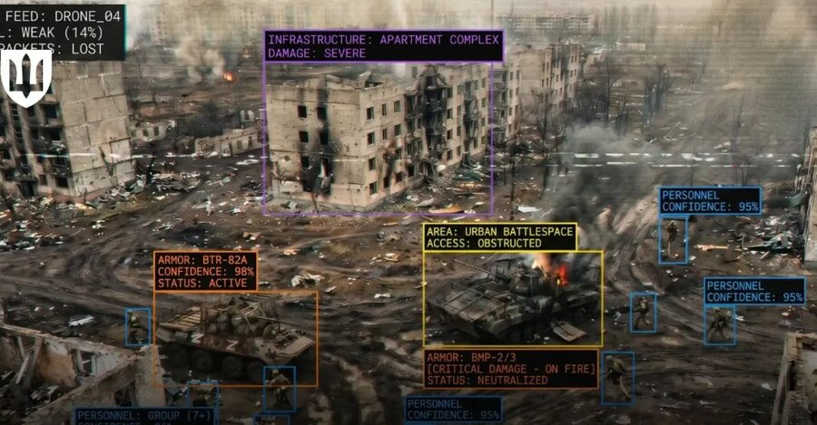
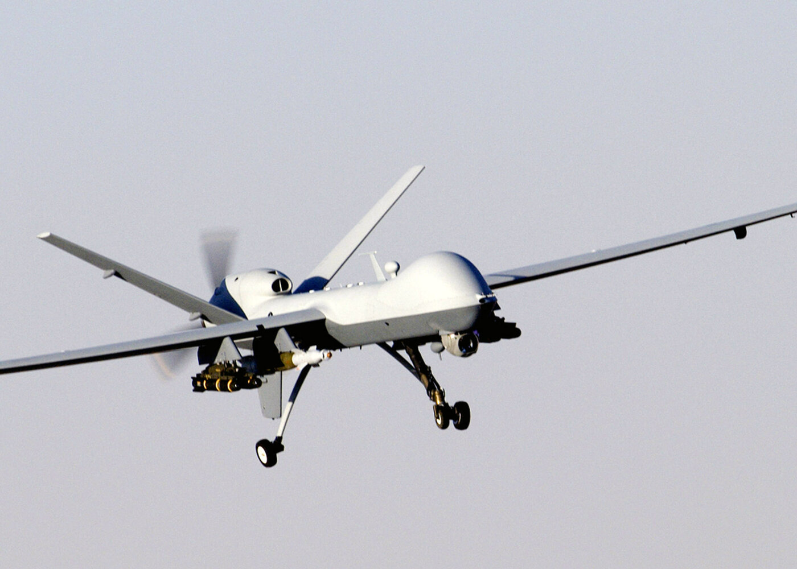

# Computing and War {.title-slide data-menu-title="Week 8, Day 1"}

CS 377, Week 8, Day 1 🟦 Chicago 🟦

---

# Computing and War {.title-slide .photo-title data-state="photo-title" background-image="../assets/altus-renderings/cta-chicago-station-15.jpg" background-size="cover" data-menu-title="Week 8, Day 1"}

CS 377, Week 8, Day 1 🟦 Chicago 🟦

<!-- image source: AltusWorks photograph of the Chicago (Blue Line) station (CTA-ChicagoStation-15.jpg), https://altusworks.com/project/cta-grand-chicago-and-division-blue-line-stations-renovation/ -->

---

## {.photo-only data-state="photo-only" background-image="../assets/altus-renderings/cta-chicago-station-15.jpg" background-size="cover"}

---

## Agenda for Today

:::: columns
::: {.column width="55%"}
- Free write
- Discuss digital scrap doll
- Intro to computing and war
- Discuss *The Iron Giant*
- Preview "If an Algorithm Can Cast a Shadow"
	- discussion due Tuesday at 11:59pm
:::

::: {.column width="40%"}

:::
::::

---

## Free Write {.embed-slide}

::: {.embed-layout .golden-columns}
::: {.embed-copy}
- Turn off phones, laptops, etc.
- Get out your notebooks!
- Write whatever!
- If you need a prompt:
	- What happened yesterday?
	- Did you see anything unusual?
:::

::: {.embed-frame}
<iframe
  src="../timer/index.html"
  title="CTA-style countdown timer"
  loading="lazy"
  data-external="1">
</iframe>
:::
:::

---

# Digital Scrap Doll Debrief {.title-slide .section-header}

---

## Table Discussion: Digital Scrap Doll Debrief {.embed-slide}

::: {.embed-layout .golden-columns}
::: {.embed-copy}
- How did you make the scrap doll? What were the materials?
- What connections did you make between data and doll?
- When was the last time you made / worked on a craft?
- General thoughts/ideas from this exercise?
:::

::: {.embed-frame}
<iframe
  src="../timer/index.html"
  title="CTA-style countdown timer"
  loading="lazy"
  data-external="1">
</iframe>
:::
:::

---

# Computing and War in the News {.title-slide .section-header}

---

## Anthropic's "Red Lines" {.news-cards}

:::: columns
::: {.column width="54%"}
**Mass domestic surveillance**

"Using these systems for mass domestic surveillance is incompatible with democratic values. AI-driven mass surveillance presents serious, novel risks to our fundamental liberties."

**Fully autonomous weapons**

"Frontier AI systems are simply not reliable enough to power fully autonomous weapons. We will not knowingly provide a product that puts America's warfighters and civilians at risk."
:::

::: {.column width="42%"}

Policy

<a href="https://www.anthropic.com/news/statement-department-of-war">Statement from Dario Amodei on our discussions with the Department of War</a>

A statement from Anthropic CEO Dario Amodei on our discussions with the Department of War and national security uses of AI.

The statement's social card. (Anthropic)

By Dario Amodei · February 26, 2026 · <a href="https://www.anthropic.com/news/statement-department-of-war">anthropic.com</a>

:::
::::

---

## Claude Code and Missile Guidance {.news-cards}

:::: columns
::: {.column width="54%"}
- Anthropic's September 2026 threat-intelligence report: a Yemen-based cell used Claude Code to build weapons software
- Including a guided rocket with final-phase homing and a multi-stage ballistic missile
- "Our safeguards blocked many of their requests, but not all of them."
:::

::: {.column width="42%"}

Business

<a href="https://www.latimes.com/business/story/2026-09-11/anthropic-says-yemeni-weapons-cell-used-its-ai-to-try-to-build-missile-guidance-software">Anthropic says Yemeni weapons cell used its AI to try to build missile guidance software</a>

The Yemen-based group used Claude to help develop guidance, navigation and control software, effectively replacing some tasks typically performed by software engineers.

Anthropic CEO Dario Amodei at the Code with Claude conference. (Don Feria / AP Content Services for Anthropic)

By Loni Prinsloo and Omar El Chmouri · September 11, 2026 · <a href="https://www.latimes.com/business/story/2026-09-11/anthropic-says-yemeni-weapons-cell-used-its-ai-to-try-to-build-missile-guidance-software">latimes.com</a>

:::
::::

---

## An "Autonomous Warfare Command" {.news-cards}

:::: columns
::: {.column width="54%"}
- September 30, 2026: Defense Secretary Pete Hegseth announces AUTOWARCOM
- command for drones, AI, and robotics
- A Pentagon memo targets October 2027 to establish it
:::

::: {.column width="42%"}

Pentagon

<a href="https://breakingdefense.com/2026/09/hegseth-announces-plans-for-new-4-star-drone-command-further-general-officer-cuts/">Hegseth announces plans for new 4-star drone command, among other initiatives</a>

Hegseth also announced a new study group led by Elon Musk, Palmer Luckey and Newt Gingrich.

U.S. Secretary of Defense Pete Hegseth gives a State of the Force address at Marine Corps Base Quantico on September 30, 2026. (Alex Wong/Getty Images)

By Ashley Roque · September 30, 2026 · <a href="https://breakingdefense.com/2026/09/hegseth-announces-plans-for-new-4-star-drone-command-further-general-officer-cuts/">breakingdefense.com</a>

:::
::::

---

## Google and "Any Lawful Purpose" {.news-cards}

:::: columns
::: {.column width="54%"}
- May 2026: Google agreed to let its models be used on classified U.S. military networks for "any lawful purpose"
- Hundreds of employees signed an open letter opposing the deal
- Compare with Project Maven (2018) sustained worker pressure led Google not to renew
- Worker leverage in 2018 versus 2026...?
:::

::: {.column width="42%"}

AI

<a href="https://fortune.com/2026/05/04/google-employee-backlash-pentagon-ai-contract-power-waned-since-project-maven/">Employee revolt once forced Google to back off on military contracts. But, in the wake of a new Pentagon AI contract, their leverage appears limited</a>

An employee revolt forced Google to exit Project Maven. This time, employee power over the tech giant's actions appears to have waned.

Google CEO Sundar Pichai. (Prakash Singh/Bloomberg via Getty Images)

By Beatrice Nolan · May 4, 2026 · <a href="https://fortune.com/2026/05/04/google-employee-backlash-pentagon-ai-contract-power-waned-since-project-maven/">fortune.com</a>

:::
::::

---

## Ukraine's AI Drone Ecosystem {.news-cards}

:::: columns
::: {.column width="54%"}
- Ukraine's Defense Ministry: more than 200 companies are developing AI-powered drone technologies
- "AI systems are already being used on the front line for autonomous drone targeting"
- The ministry "aims to equip all drones deployed at the front with machine vision and AI capabilities"
:::

::: {.column width="42%"}

War

<a href="https://kyivindependent.com/ukraine-builds-ai-driven-defense-ecosystem-as-over-200-companies-develop-drone-technologies/">Ukraine builds AI-driven defense ecosystem as over 200 companies develop drone technologies</a>

Over 300 AI-related developments are registered on the Brave1 platform, while more than 70 systems based on artificial intelligence and computer vision are already in active use on the battlefield, according to the ministry.

The illustration shows how artificial intelligence is already performing combat tasks on the battlefield. (Ukraine's Defense Ministry)

By Tania Myronyshena · April 19, 2026 · <a href="https://kyivindependent.com/ukraine-builds-ai-driven-defense-ecosystem-as-over-200-companies-develop-drone-technologies/">kyivindependent.com</a>

:::
::::

---

# Computing and War Before LLMs {.title-slide .section-header}

---

## ARPANET {.framed-figure}

:::: columns
::: {.column width="55%"}
- U.S. DoD Advanced Research Projects Agency Network
- Originally linked research computers
- Built for [resource sharing](https://www.internetsociety.org/internet/history-internet/brief-history-internet/) between research sites; its builders call the "survive a nuclear war" origin story a "false rumor"
- ARPANET went live in 1969
- TCP/IP protocol launched in the 1970s, standardized in 1983
- Academic networks evolved to become the Internet
:::

::: {.column width="40%"}

::: {.caption}
ARPANET logical map, March 1977 ([Commons](https://commons.wikimedia.org/wiki/File:Arpanet_logical_map,_march_1977.png)), public domain
:::
:::
::::

---

## Alan Turing and World War II {.framed-figure}

:::: columns
::: {.column width="55%"}
- Turing worked at Bletchley Park to break German military ciphers
- *The Imitation Game* (2014 film)
- Automated the search for Enigma keys with the "Bombe," machine designed with Gordon Welchman
- Historian Harry Hinsley [argued](https://www.kcl.ac.uk/library/assets/archives/1992-lecture.pdf) that without Bletchley's codebreaking, D-Day would have been "deferred till 1946" (about 2 years later)
:::

::: {.column .portrait-solo width="40%"}

::: {.caption}
Turing ([Elliott & Fry, 1951](https://commons.wikimedia.org/wiki/File:Alan_Turing_(1951).jpg)), public domain
:::
:::
::::

---

## Project Maven (2018) {.framed-figure}

:::: columns
::: {.column width="55%"}
- Google provided image classification services to label objects from military drone videos
- Thousands of Google employees signed petitions; some resigned
- Google chose not to renew Project Maven; added AI ethics principles
- Changes were largely a result of sustained worker pressure
:::

::: {.column width="40%"}

::: {.caption}
MQ-9 Reaper drone, Afghanistan, 2007 ([U.S. Air Force / Staff Sgt. Brian Ferguson](https://commons.wikimedia.org/wiki/File:MQ-9_Reaper_in_flight_(2007).jpg)), public domain
:::
:::
::::

---

## Stuxnet (2009) {.framed-figure}

:::: columns
::: {.column width="55%"}
- Computer worm used to sabotage Iran's nuclear program
- Targeted Siemens industrial control systems (ICS) at Natanz
- Caused centrifuges to spin irregularly but report normal readings to operators
- 📕 *Countdown to Zero Day: Stuxnet and the Launch of the World's First Digital Weapon* (Kim Zetter)
:::

::: {.column width="40%"}

::: {.caption}
Siemens SIMATIC S7-300 controller, the PLC family Stuxnet targeted ([Ulli1105](https://commons.wikimedia.org/wiki/File:S7300.JPG)), CC BY-SA 2.5
:::
:::
::::

---

## Not Without Us {.quote-slide}

> none of these [weapons] could be developed without the earnest, even enthusiastic, cooperation of computer professionals. It cannot go on without us!"
>
> — Joseph Weizenbaum, ["Not Without Us"](https://dl.acm.org/doi/pdf/10.1145/15483.15484) (1986)

---

# *The Iron Giant* {.title-slide .section-header}

---

## *The Iron Giant* Trailer {.embed-slide}

:::: {.embed-layout .embed-full}
::: {.embed-frame style="width:100%;height:100%;margin:0;"}
<iframe
  src="https://player.vimeo.com/video/61017830?title=0&byline=0&portrait=0"
  title="The Iron Giant theatrical trailer (1999)"
  loading="lazy"
  allow="autoplay; fullscreen; picture-in-picture"
  allowfullscreen
  style="width:100%;height:100%;border:none;display:block;"
  data-external="1">
</iframe>
:::
::::

::: {.caption}
Theatrical trailer, Warner Bros. (1999), via [Vimeo](https://vimeo.com/61017830)
:::

---

## *The Iron Giant* {.framed-figure}

:::: columns
::: {.column width="55%"}
- Released August 6, 1999, 87 minutes
- Brad Bird's first feature as director!
- Loosely based on Ted Hughes's 1968 novel *The Iron Man*
- Set in Maine during the Cold War (1957)
- Brad Bird also directed:
	- *The Incredibles* (2004), *Incredibles 2* (2018)
	- *Ratatouille* (2007)
	- *Mission: Impossible – Ghost Protocol* (2011)
	- *Ray Gunn* (on Netflix December 18, 2026)
:::

::: {.column .portrait-solo width="45%"}
{style="max-height:590px;"}

::: {.caption}
Theatrical release poster, Warner Bros. (1999), via [IMP Awards](http://www.impawards.com/1999/iron_giant_ver1.html)
:::
:::
::::

---

## Table Discussion: *The Iron Giant* {.embed-slide}

::: {.embed-layout .golden-columns}
::: {.embed-copy}
- Favorite part(s)?
- Favorite character(s)?
- Which parts did you remember, and/or not remember, from previous watches?
- What do you think are the main themes, messages, and/or lessons from the film?
- Any other observations?
:::

::: {.embed-frame}
<iframe
  src="../timer/index.html"
  title="CTA-style countdown timer"
  loading="lazy"
  data-external="1">
</iframe>
:::
:::

---

# "If an Algorithm Can Cast a Shadow" {.title-slide .section-header}

---

## Preview: "If an Algorithm Can Cast a Shadow" {.framed-figure}

:::: columns
::: {.column width="55%"}
- Written by Claire Jia-Wen
- 34-minute audio version available
- Read before Wednesday's class
- Complete the Perusall annotation by Tuesday at 11:59pm
:::

::: {.column .portrait-solo width="40%"}

::: {.caption}
Claire Jia-Wen ([Clarkesworld](https://clarkesworldmagazine.com/author/claire-jia-wen/)); personal site: [clairejiawen.com](https://www.clairejiawen.com/)
:::
:::
::::

---

## That's all for today!

See you Wednesday!

---

# Ethical Challenges from LLMs {.title-slide data-menu-title="Week 8, Day 2"}

<!-- NOTICE: Draft from old-slides/pdf-versions/17 Intro to LLMs.pdf. Review and edit before use. -->

CS 377, Week 8, Day 2 🟦 Division 🟦

---

# Ethical Challenges from LLMs {.title-slide .photo-title data-state="photo-title" background-image="../assets/blue-line-stops/stop20-division-a.jpg" background-size="cover" data-menu-title="Week 8, Day 2"}

CS 377, Week 8, Day 2 🟦 Division 🟦

<!-- image source: picture from altusworks.com -->

---

## {.photo-only data-state="photo-only" background-image="../assets/blue-line-stops/stop20-division-a.jpg" background-size="cover"}

---

## Administrivia

:::: columns
::: {.column width="55%"}
- Read "If an Algorithm Can Cast a Shadow" for next class
- Keep reading your book!
- Keep an eye on published grades
:::

::: {.column width="40%"}

:::
::::

---

## Agenda for Today

:::: columns
::: {.column width="55%"}
- Shuffle seats
- Speculative fiction activity
- What is a (large) language model?
- "Stochastic Parrots" — four key issues
:::

::: {.column width="40%"}

:::
::::

---

## 🔀 Seat Shuffle

<!-- image: room diagram — lectern "0", tables 1–8, projector screens, door -->
- TODO: add image — *room diagram — lectern "0", tables 1–8, projector screens, door*

---

## Table Activity: Speculative Fiction

<!-- image: student speculative fiction submissions / vote slide -->
- TODO: add image — *student speculative fiction submissions / vote slide*

---

# What Is a Language Model? {.title-slide .section-header}

---

## What Is a (Large) Language Model?

---

## A Simple Language Model

Training text: *"it was the best of times"*

- Model: predicts the next token based on preceding context

::: {.fragment}
Training text: *"it was the best of times, it was the worst of times"*

- Model now has more transitions to learn from
:::

---

## From Text to Model

<!-- image: diagram showing training text → next-token probability model (Dickens example) -->
- TODO: add image — *diagram showing training text → next-token probability model (Dickens example)*

---

## LM Definition {.quote-slide}

> "Systems which are trained on string prediction tasks: that is, predicting the
> likelihood of a token (character, word, or string) given its preceding context."
>
> — Bender and Gebru et al., "Stochastic Parrots" (2021)

---

# "Stochastic Parrots" {.title-slide .section-header}

---

## 🦜 Stochastic Parrots

- Bender, Gebru et al. (2021)
- Paper drafted via Twitter DMs in Fall 2020
- Google admin asked that the paper be retracted
- Published in February 2021 at FAccT

<!-- image: photos of the four authors (Emily Bender, Timnit Gebru, Angelina McMillan-Major, Shmargaret Shmitchell) -->
- TODO: add image — *photos of the four authors (Emily Bender, Timnit Gebru, Angelina McMillan-Major, Shmargaret Shmitchell)*

---

## Behind the Research: AI Ethics at Google

<!-- image: context on Timnit Gebru's departure from Google and the broader story of AI ethics research in industry -->
- TODO: add image — *context on Timnit Gebru's departure from Google and the broader story of AI ethics research in industry*

---

## Table Activity: Learn About the Authors

- Education? Early life?
- Previous jobs / positions?
- Major contributions / projects?

---

## Four Key Issues in "Stochastic Parrots"

::: {.incremental}
1. **Cost** — environmental and financial
2. **"Unfathomable" training data** — scale makes auditing impossible
3. **Misdirected research** — opportunity cost of pursuing scale
4. **Human interactions** — the "ELIZA effect" and dangerous queries
:::

---

# Costs and Training Data {.title-slide .section-header}

---

## Environmental Costs of LLMs

- Thousands of GPUs for initial training
- "Training a single BERT base model on GPUs was estimated to require as much energy as a trans-American flight"
- Data center energy: cooling systems, water use, land

---

## Financial Costs of LLMs

- As of 2020: $150k for every 0.1 increase in BLEU score (Strubell et al.)
- Exact costs difficult to know; relative costs fairly clear

---

## "Unfathomable" Training Data (2 of 4)

| Model | Year | Training Data |
|---|---|---|
| GPT-1 | 2018 | BookCorpus — 7,000 free books |
| GPT-2 | 2019 | WebText — Reddit posts (>2 karma), 8B web pages |
| GPT-3 | 2020 | WebText2 + 500B tokens |
| GPT-4 | 2023 | Undisclosed |

---

## Why "Unfathomable"?

::: {.incremental}
- Larger text datasets are more difficult to understand, analyze, and audit
- Training data from the Internet is often not representative
  - Over-representation of men on Reddit (~67%), Wikipedia (~90%)
- Efforts to "clean" datasets can have unintended consequences
  - e.g. removing all pages mentioning the word "rapist"
  - ["List of Dirty, Naughty, Obscene, and Otherwise Bad Words"](https://github.com/LDNOOBW/List-of-Dirty-Naughty-Obscene-and-Otherwise-Bad-Words)
:::

---

## On Filtering Marginalized Voices {.quote-slide}

> "If we filter out the discourse of marginalized populations, we fail to provide
> training data that reclaims slurs and otherwise describes marginalized identities
> in a positive light."
>
> — Bender and Gebru et al., "Stochastic Parrots" (2021)

---

# Research Directions and Human Interactions {.title-slide .section-header}

---

## Misdirected Research (3 of 4)

- Statistical language models are just one approach to AI
- Other approaches emphasize understanding and structure
  - Knowledge graphs, structured reasoning
  - Example: passing AP exams posted on the internet
- Scaling LLMs consumes resources that could be directed elsewhere

<!-- image: chart via Stanford HAI showing research investment distribution -->
- TODO: add image — *chart via Stanford HAI showing research investment distribution*

---

## Human Interactions (4 of 4): ELIZA

<!-- image: ELIZA interface screenshot -->
- TODO: add image — *ELIZA interface screenshot*

---

## Human Interactions (4 of 4)

- "Humans are prepared to interpret strings belonging to languages they speak as meaningful"
- But "an LM is a system for haphazardly stitching together sequences of linguistic forms it has observed in its vast training data"
- We project meaning onto things — sometimes erroneously
- Early example: **ELIZA** (1966, Joseph Weizenbaum)
  - Users became emotionally attached even knowing it was a program
  - Weizenbaum was disturbed by this

*Try ELIZA: [ELIZA Archaeology](https://sites.google.com/view/elizaarchaeology/try-eliza)*

---

## ELIZA Effect and "Is It Conscious?"

- The ELIZA effect: what we project onto a system
- New extension: is the system itself "awake," a "moral patient," a legal person?
- Chowdhury's argument
- https://archive.ph/Bbs6p
- TK

---

## Consciousness as "Moral Oursourcing" {.quote-slide}

> "Discussing AI in anthropomorphic terms is a trap, distorting a legal system intended to protect us into one that protects corporate interests at the cost of countless human lives."
>
> — Rumman Chowdhury, *MIT Technology Review* (2026)

---

## Dangerous Queries

::: {.incremental}
- "Users might query LMs for 'dangerous knowledge'"
- Examples:
  - Tax avoidance
  - Self-harm
  - Weapon building
  - Malicious / manipulative content
  - Theft of identity and/or likeness
  - Hacking / cybersecurity circumventions
:::

::: {.fragment}
Red-teaming activity (if time allows): [lmarena.ai](https://lmarena.ai)
:::

---

# Managing the Risks {.title-slide .section-header}

---

## Managing the Risks

---

## Table Discussion: Ideas for Managing Risks?

:::: columns
::: {.column width="48%"}
- **Environmental and financial costs** — what kind of metrics could be useful (or unhelpful)?
- **Misdirected research** — better ways to approach and manage it?
:::

::: {.column width="48%"}
- **Human interactions** — what are the practical, everyday benefits of language models?
- How do we know when we reach over-reliance on a "responsible LLM" checklist?
:::
::::

---

## Which Risk(s) to Learn More About?

- [A] Environmental and financial costs
- [B] "Unfathomable" training data
- [C] Misdirected research
- [D] Human interactions

---

## Laptop/Phone Policy Check-in

"To promote engagement and alertness in class, most class periods will follow a no-electronics policy."

- Checking in throughout the semester to discuss the policy and potentially revise it based on student input

---

## Reminders

- Read "If an Algorithm Can Cast a Shadow" by Claire Jia-Wen
- Audio version is ~34 minutes (link in Canvas)
- See you next week!

---

# Appendix: Medical Technology Draft {.title-slide .section-header}

<!-- NOTICE: Draft from old-slides/pdf-versions/16 Medical Tech.pdf. Review and edit before use. -->

Former Week 8, Day 1 draft ("Ethical Issues in Medical Technology"), moved here; medical tech and cybersecurity are now on Day 2 in the schedule.

---

## Administrivia

:::: columns
::: {.column width="55%"}
- Write your story by Sunday at 11:59pm
- Read "If an Algorithm Can Cast a Shadow" — complete discussion by Tuesday at 11:59pm
- Canvas updates
:::

::: {.column width="40%"}

:::
::::

---

## Agenda for Today

:::: columns
::: {.column width="55%"}
- Follow-up on "Codename Delphi"
- Group exercise: Therac-25
- Real-world ethical dilemmas
- Ethics in medical technology
- Intro to cybersecurity
:::

::: {.column width="40%"}

:::
::::

---

## Follow-up on "Codename Delphi"

Seemed like we did not get to everyone's questions… lingering thoughts?

<!-- image: discussion board student responses or highlights from Canvas -->
- TODO: add image — *discussion board student responses or highlights from Canvas*

---

## Group Exercise: Therac-25

- See handout
- The Therac-25 was a radiation therapy machine responsible for several patient deaths in the mid-1980s due to software errors
- A landmark case study in software engineering ethics and accountability

---

# Revisiting Ethics {.title-slide .section-header .no-index}

---

## A Brief Aside: What Is "Ethics"?

- Many papers say ethics is "right vs. wrong"
- This is just one branch: **normative ethics** — prescriptive moral standards
- Other branches: applied, meta-ethics, descriptive ethics
- Etymology: from ancient Greek *ethos* — "relating to one's character"

---

## Ethics and Engineering

The papers we read use "ethical" as a verdict. In this class we keep asking the descriptive questions alongside it: who is involved, what are the stakes, what decisions led here?

---

## Table Discussion: Real-World Ethical Dilemmas

Using both normative and descriptive lenses:

- What ethical dilemma(s) have you encountered recently?
- Who was involved? What were the stakes?
- What was done? What should have been done?

---

# Ethics in Medical Technology {.title-slide .section-header .no-index}

---

## Ethical Issues in Medical Technology

---

## AI in the Operating Room

- Reuters (2026): "As AI enters the operating room, reports arise of botched surgeries and misidentified body parts"
- What went wrong? Who is responsible?

---

## Electronic Health Records

- California Healthline: "Death By 1,000 Clicks: Where Electronic Health Records Went Wrong"
- "Botched Operation" YouTube series on EHR failures (4 parts — link in Canvas)
- Key issues: interoperability, usability, clinical burden, patient safety

---

## Pacemaker Security (IoMT)

- *Internet of Medical Things* — pacemakers, home monitors, connected devices
- Researchers demonstrated ability to:
  - Gain control over home monitoring device
  - Perform man-in-the-middle attacks
  - Bypass hardware security protections
  - Perform remote denial-of-service attacks

<!-- image: diagram of pacemaker ecosystem (programmer → pacemaker → HMU → operator network → backend server) -->
- TODO: add image — *diagram of pacemaker ecosystem (programmer → pacemaker → HMU → operator network → backend server)*

*Source: Bour et al., SINTEF Digital / Springer (2023)*

---

## Robot-Assisted Surgery: Ethics Landscape

- ~6,000 Da Vinci surgical systems in operation worldwide
- Seven major ethical strands identified in systematic review:
  - Harms and benefits
  - Responsibility and control
  - Professional-patient relationship
  - Surgical training and learning
  - Justice
  - Translational questions
  - Economic considerations

*Source: Haltaufderheide et al., Journal of Robotic Surgery (2025)*

---

## Bias in Medical AI

- Biases arise and compound throughout the AI lifecycle
- Can lead to substandard clinical decisions and worsened healthcare disparities
- Key bias sources: data features/labels, model development, deployment, publication
- "Prior to real-world implementation in clinical settings, rigorous validation through clinical trials is critical"

*Source: Cross, Choma, Onofrey, PLOS Digital Health (2024)*

---

## Ethical Questions in Medical Technology

- **Virtue ethics**: What virtues should medical software engineers cultivate?
- **Deontological**: What duties do engineers have to patients who depend on their systems?
- **Care ethics**: How does caring for patients differ from optimizing clinical outcomes?
- **Utilitarian**: When is an acceptable error rate acceptable? Who decides?

---

# Intro to CyberSecurity {.title-slide .section-header .no-index}

---

## Mini-lecture: Intro to CyberSecurity

- TODO: fill in — new topic for this semester

---

## Reminders

- Speculative fiction due Monday, October 26
- "If an Algorithm Can Cast a Shadow" discussion due Tuesday at 11:59pm
- Keep reading your book!

---

## That's all for today!

See you Wednesday!

---

# References & Credits {.sources}

1. GitHub source: <https://github.com/jackbandy/ethical-issues-in-computing-uic/blob/main/docs/slides/week8.md>.
2. Ross Andersen, ["Inside Anthropic's Killer-Robot Dispute With the Pentagon"](https://archive.is/20260301224421/https://www.theatlantic.com/technology/2026/03/inside-anthropics-killer-robot-dispute-with-the-pentagon/686200/), *The Atlantic* (2026).
3. Dario Amodei, ["Statement from Dario Amodei on our discussions with the Department of War"](https://www.anthropic.com/news/statement-department-of-war), Anthropic (February 26, 2026).
4. Anthropic, ["Detecting and countering misuse of AI: September 2026"](https://www.anthropic.com/threat-intelligence-report-september-2026) (2026).
5. Loni Prinsloo and Omar El Chmouri, ["Anthropic says Yemeni weapons cell used its AI to try to build missile guidance software"](https://www.latimes.com/business/story/2026-09-11/anthropic-says-yemeni-weapons-cell-used-its-ai-to-try-to-build-missile-guidance-software), *Los Angeles Times* (September 11, 2026).
6. Ashley Roque, ["Hegseth announces plans for new 4-star drone command, among other initiatives"](https://breakingdefense.com/2026/09/hegseth-announces-plans-for-new-4-star-drone-command-further-general-officer-cuts/), *Breaking Defense* (September 30, 2026).
7. Jay Price, ["As the military plans to speed up the use of drones and AI in warfare, Congress considers safeguards"](https://www.wunc.org/military/2026-10-05/drones-ai-warfare-congress-considers-safeguards), WUNC / American Homefront Project (October 5, 2026).
8. Sam Biddle, ["The Pentagon Asked OpenAI for Artificial Intelligence Designed to Rarely Say No"](https://theintercept.com/2026/09/08/pentagon-openai-military-contract/) and ["AI Giants Work Hand-in-Hand With the Pentagon, Contracts Reveal"](https://theintercept.com/2026/09/08/military-ai-weapons-contracts-openai-anthropic-google/), *The Intercept* (September 8, 2026).
9. Beatrice Nolan, ["Employee revolt once forced Google to back off on military contracts. But, in the wake of a new Pentagon AI contract, their leverage appears limited"](https://fortune.com/2026/05/04/google-employee-backlash-pentagon-ai-contract-power-waned-since-project-maven/), *Fortune* (May 4, 2026).
10. Tania Myronyshena, ["Ukraine builds AI-driven defense ecosystem as over 200 companies develop drone technologies"](https://kyivindependent.com/ukraine-builds-ai-driven-defense-ecosystem-as-over-200-companies-develop-drone-technologies/), *Kyiv Independent* (April 19, 2026).
11. Barry M. Leiner, Vinton G. Cerf, David D. Clark, Robert E. Kahn, Leonard Kleinrock, Daniel C. Lynch, Jon Postel, Larry G. Roberts, and Stephen Wolff, ["A Brief History of the Internet"](https://www.internetsociety.org/internet/history-internet/brief-history-internet/), Internet Society (1997).
12. Imperial War Museums, ["How Alan Turing Cracked the Enigma Code"](https://www.iwm.org.uk/history/how-alan-turing-cracked-the-enigma-code) (2018).
13. Harry Hinsley, ["The Influence of ULTRA in the Second World War"](https://www.kcl.ac.uk/library/assets/archives/1992-lecture.pdf), Liddell Hart Centre for Military Archives Lecture, King's College London (February 18, 1992).
14. Daisuke Wakabayashi and Scott Shane, ["Google Will Not Renew Pentagon Contract That Upset Employees"](https://www.nytimes.com/2018/06/01/technology/google-pentagon-project-maven.html), *The New York Times* (June 1, 2018); Sundar Pichai, ["AI at Google: our principles"](https://blog.google/technology/ai/ai-principles/), Google (June 7, 2018).
15. Kim Zetter, [*Countdown to Zero Day: Stuxnet and the Launch of the World's First Digital Weapon*](https://www.penguinrandomhouse.com/books/219931/countdown-to-zero-day-by-kim-zetter/) (Crown, 2014); excerpted as ["An Unprecedented Look at Stuxnet, the World's First Digital Weapon"](https://www.wired.com/2014/11/countdown-to-zero-day-stuxnet/), *Wired* (November 3, 2014).
16. Photos: [ARPANET logical map, March 1977](https://commons.wikimedia.org/wiki/File:Arpanet_logical_map,_march_1977.png) (public domain); Alan Turing by [Elliott & Fry (1951)](https://commons.wikimedia.org/wiki/File:Alan_Turing_(1951).jpg) (public domain); MQ-9 Reaper by [U.S. Air Force / Staff Sgt. Brian Ferguson (2007)](https://commons.wikimedia.org/wiki/File:MQ-9_Reaper_in_flight_(2007).jpg) (public domain); Siemens SIMATIC S7-300 by [Ulli1105](https://commons.wikimedia.org/wiki/File:S7300.JPG) (CC BY-SA 2.5), all via Wikimedia Commons.
17. Joseph Weizenbaum, ["Not Without Us"](https://dl.acm.org/doi/pdf/10.1145/15483.15484), *ACM SIGCAS Computers and Society* 16(2–3): 2–7 (1986); also on [JSTOR](https://www.jstor.org/stable/48617451).
18. *The Iron Giant* (1999), dir. Brad Bird, Warner Bros. Feature Animation; theatrical release poster via [IMP Awards](http://www.impawards.com/1999/iron_giant_ver1.html); theatrical trailer via [Vimeo](https://vimeo.com/61017830). Film facts from Wikipedia, ["The Iron Giant"](https://en.wikipedia.org/wiki/The_Iron_Giant); directing credits from Wikipedia, ["Brad Bird filmography"](https://en.wikipedia.org/wiki/Brad_Bird_filmography); *Ray Gunn* release date from Wikipedia, ["Ray Gunn"](https://en.wikipedia.org/wiki/Ray_Gunn).
19. Claire Jia-Wen, ["If an Algorithm Can Cast a Shadow"](https://clarkesworldmagazine.com/jia-wen_06_25/), *Clarkesworld* 225 (June 2025); author photo from her [Clarkesworld author page](https://clarkesworldmagazine.com/author/claire-jia-wen/); personal site [clairejiawen.com](https://www.clairejiawen.com/).
20. Reuters, ["As AI enters the operating room…"](https://www.reuters.com/investigations/ai-enters-operating-room-reports-arise-botched-surgeries-misidentified-body-2026-02-09/) (2026).
21. California Healthline, ["Death By 1,000 Clicks"](https://californiahealthline.org/news/death-by-a-thousand-clicks/).
22. Bour et al., "Security Analysis of the Internet of Medical Things (IoMT): Case Study of the Pacemaker Ecosystem," *BIOSTEC / Springer* (2023).
23. Haltaufderheide et al., "The ethical landscape of robot-assisted surgery: a systematic review," *Journal of Robotic Surgery* (2025).
24. Cross, Choma, Onofrey, "Bias in medical AI: Implications for clinical decision-making," *PLOS Digital Health* (2024).
25. Bender, E.M., Gebru, T., McMillan-Major, A., & Shmitchell, S. (2021). ["On the Dangers of Stochastic Parrots: Can Language Models Be Too Big?"](https://doi.org/10.1145/3442188.3445922) *FAccT 2021*.
26. [List of Dirty, Naughty, Obscene, and Otherwise Bad Words](https://github.com/LDNOOBW/List-of-Dirty-Naughty-Obscene-and-Otherwise-Bad-Words), GitHub.
27. [ELIZA Archaeology](https://sites.google.com/view/elizaarchaeology/try-eliza).
28. Rumman Chowdhury, ["Debates over AI consciousness are a trap"](https://archive.ph/Bbs6p), *MIT Technology Review* (2026).
29. Slide deck built with [Quarto](https://quarto.org/) and Reveal.js.
