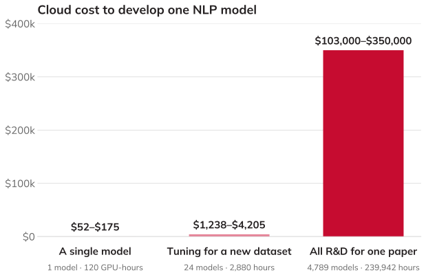

# LLMs, Continued {.title-slide data-menu-title="Week 9, Day 1"}

CS 377, Week 9, Day 1 🟦 Damen 🟦

---

# LLMs, Continued {.title-slide .photo-title data-state="photo-title" background-image="../assets/blue-line-stops-better/stop21-damen-c.jpg" background-size="cover" data-menu-title="Week 9, Day 1"}

CS 377, Week 9, Day 1 🟦 Damen 🟦

<!-- image source: photo by Graham Garfield -->

---

## {.photo-only data-state="photo-only" background-image="../assets/blue-line-stops-better/stop21-damen-c.jpg" background-size="cover"}

---

## Agenda for Today

:::: columns
::: {.column width="55%"}
- Book check-in
- What is an LLM?
- "Stochastic Parrots"
- LLMs in the news
:::

::: {.column width="40%"}

:::
::::

---

## Invitation

Turn off phones, laptops, and other distractions

---

## Table Discussion: Book Check-in {.embed-slide}

::: {.embed-layout .golden-columns}
::: {.embed-copy}
- How much have you read?
- What helps you read?
- How are you taking notes?
- What are you learning?
- What are your ideas for your presentation? Uneasy?
- What does your reading schedule look like for the next few weeks?
:::

::: {.embed-frame}
<iframe
  src="../timer/index.html"
  title="CTA-style countdown timer"
  loading="lazy"
  data-external="1">
</iframe>
:::
:::

---

# What Is a Language Model? {.title-slide .section-header}

---

## What Is a (Large) Language Model?

---

## A Simple Language Model {.framed-figure}

:::: columns
::: {.column width="40%"}
Training text: *"it was the best of times"*

- Model: predicts the next token based on preceding context
:::

::: {.column width="55%"}
{fig-alt="Next-word graph for 'it was the best of times': a chain it, was, the, best, of, times, each arrow labeled 100%; 'times' has no next word"}
:::
::::

---

## A Simple Language Model {.framed-figure}

:::: columns
::: {.column width="40%"}
Training text: *"it was the best of times, it was the worst of times"*

- Model now has more transitions to learn from
:::

::: {.column width="55%"}
{fig-alt="Next-word graph for 'it was the best of times, it was the worst of times': 'the' now goes to 'best' 50% and 'worst' 50%, 'worst' goes to 'of', and 'times' loops back to 'it'; new parts highlighted in amber"}

::: {.caption}
New transitions in amber
:::
:::
::::

---

## From Text to Model {.framed-figure}

:::: columns
::: {.column width="40%"}
Training text: *"it was the best of times, it was the worst of times, it was the age of wisdom, it was the age of foolishness"*

- Each word is a node
- Each arrow is a next-word probability learned from the text
:::

::: {.column width="55%"}
{fig-alt="Directed graph of next-word transitions with percentage labels, e.g. 'the' goes to 'best' 25%, 'worst' 25%, and 'age' 50%"}

::: {.caption}
Next-word graph from the opening of *A Tale of Two Cities* (Charles Dickens, 1859)
:::
:::
::::

---

## Language Model Definition {.quote-slide}

> "Systems which are trained on string prediction tasks: that is, predicting the likelihood of a token (character, word, or string) given its preceding context."
>
> — Bender and Gebru et al., "Stochastic Parrots" (2021)

---

# "Stochastic Parrots" {.title-slide .section-header}

---

## 🦜 Stochastic Parrots

- Bender, Gebru et al. (2021)
- Paper drafted via Twitter DMs in Fall 2020
- Google admin asked that the paper be retracted
- Published in February 2021 at FAccT

---

## The Authors {.smaller}

:::: {.portrait-grid}
::: {.portrait-card}

::: {.portrait-text}
**Emily M. Bender**

::: {.caption}
Linguist, University of Washington ([King of Hearts](https://commons.wikimedia.org/wiki/File:Emily_M_Bender_CHM_Mountain_View_March_2025.jpg), CC BY-SA 4.0)
:::
:::
:::

::: {.portrait-card}

::: {.portrait-text}
**Timnit Gebru**

::: {.caption}
Then co-lead of Google's Ethical AI team ([TechCrunch](https://commons.wikimedia.org/wiki/File:Timnit_Gebru_crop.jpg), CC BY 2.0)
:::
:::
:::

::: {.portrait-card}

::: {.portrait-text}
**Angelina McMillan-Major**

::: {.caption}
Then a PhD student in computational linguistics, University of Washington (photo source TBD)
:::
:::
:::

::: {.portrait-card}

::: {.portrait-text}
**"Shmargaret Shmitchell"**

::: {.caption}
Margaret Mitchell's pseudonym; then co-lead of Google's Ethical AI team (photo source TBD)
:::
:::
:::
::::

---

## Behind the Research: AI Ethics at Google {.framed-figure}

:::: columns
::: {.column width="55%"}
- December 3, 2020: Gebru says Google fired her over the paper
- December 4, 2020: *MIT Technology Review* publishes ["We read the paper that forced Timnit Gebru out of Google. Here's what it says."](https://www.technologyreview.com/2020/12/04/1013294/google-ai-ethics-research-paper-forced-out-timnit-gebru/)
- February 19, 2021: Google fires Margaret Mitchell, the team's other co-lead
- June 2021: Vox, "Google says it's committed to ethical AI research. Its ethical AI team isn't so sure."
:::

::: {.column width="40%"}
{style="max-height:560px;"}

::: {.caption}
News coverage, December 2020 to June 2021 (Google News)
:::
:::
::::

---

## Four Key Issues in "Stochastic Parrots"

::: {.incremental}
1. **Cost**: environmental and financial
2. **"Unfathomable" training data**: scale makes auditing impossible
3. **Misdirected research**: i.e. opportunity costs
4. **Human interactions**: the "ELIZA effect" and dangerous queries
:::

---

# Costs and Training Data {.title-slide .section-header}

---

## Environmental Costs of LLMs {.framed-figure}

:::: columns
::: {.column width="45%"}
- Thousands of GPUs for initial training
- "Training a single BERT base model on GPUs was estimated to require as much energy as a trans-American flight"
- Data center energy: cooling systems, water use, land
:::

::: {.column width="50%"}
{fig-alt="Google's data center in The Dalles, Oregon, seen behind a fenced electrical substation and dry grass"}

::: {.caption}
Google's data center in The Dalles, Oregon, behind its substation ([Visitor7](https://commons.wikimedia.org/wiki/File:Google_Data_Center,_The_Dalles.jpg), CC BY-SA 3.0)
:::
:::
::::

---

## Financial Costs of LLMs {.framed-figure}

:::: columns
::: {.column width="40%"}
- As of 2020: $150k for every 0.1 increase in BLEU score (Strubell et al.)
- Exact costs difficult to know; relative costs fairly clear
:::

::: {.column width="55%"}
{fig-alt="Bar chart of the cloud cost to develop one NLP model: one model $52 to $175, tuning for a new dataset $1,238 to $4,205, all R&D for one paper $103,000 to $350,000"}

::: {.caption}
Data: Strubell, Ganesh & McCallum, ["Energy and Policy Considerations for Deep Learning in NLP"](https://aclanthology.org/P19-1355/), ACL 2019, Table 4
:::
:::
::::

---

## "Moratorium" for Data Centers in Chicago {.news-cards}

:::: columns
::: {.column width="54%"}
- September 23, 2026: Mayor and alderpeople introduced ordinance
- "pause the construction of any new data center for 12 months"
- It would also block the "material expansion" of existing ones
- "Chicago is open for business, but we are not for sale." (Mayor Brandon Johnson)
:::

::: {.column width="42%"}

Politics

<a href="https://blockclubchicago.org/2026/09/23/year-long-ban-on-new-data-centers-pitched-by-chicago-mayor-brandon-johnson/">Year-Long Ban On New Data Centers Pitched By Chicago Mayor Brandon Johnson</a>

The moratorium would be in place while the city formulates additional regulations. An industry group has already blasted the proposal as bad for the economy.

A data center on the Lower West Side on Aug. 28, 2025. (Colin Boyle/Block Club Chicago)

By Quinn Myers · September 23, 2026 · <a href="https://blockclubchicago.org/2026/09/23/year-long-ban-on-new-data-centers-pitched-by-chicago-mayor-brandon-johnson/">blockclubchicago.org</a>

:::
::::

---

## Data Centers in Illinois {.news-cards}

:::: columns
::: {.column width="54%"}
- report from the Illinois Economic Policy Institute, UIUC
- "$57 billion worth of new data center projects through 2035"
- "121,000 mostly temporary skilled trade and construction jobs"
- "nearly $300 million more in annual property tax revenues"
- "Residents could have to pay $12 more per month in electric bills."
:::

::: {.column width="42%"}

Morning Edition

<a href="https://chicago.suntimes.com/morning-edition/2026/10/02/data-centers-illinois-broadview-six-midterm-elections">Data centers could bring boost in jobs, tax revenues — and bills</a>

Data center projects planned in Illinois over the next decade could generate tens of thousands of new jobs and hundreds of millions of dollars in new tax revenues, but also drive up utility bills.

Construction on T5 data center in Northlake in 2024. (Anthony Vazquez/Sun-Times file)

Reporting by Mawa Iqbal · October 2, 2026 · <a href="https://chicago.suntimes.com/morning-edition/2026/10/02/data-centers-illinois-broadview-six-midterm-elections">suntimes.com</a>

:::
::::

---

## "Unfathomable" Training Data (2 of 4)

| Model | Year | Training Data |
|---|---|---|
| GPT-1 | 2018 | BookCorpus (7,000 books) |
| GPT-2 | 2019 | WebText: Reddit posts (>2 karma), 8B web pages |
| GPT-3 | 2020 | WebText2 + 500B tokens |
| GPT-4 | 2023 | Undisclosed |

---

## Why "Unfathomable"?

::: {.incremental}
- Larger text datasets are inherently more difficult to understand
- Training data from the Internet is often not representative
  - Over-representation of men on Reddit (~67%), Wikipedia (~90%)
- Efforts to "clean" datasets can have unintended consequences
  - e.g. removing all pages mentioning the word "rapist"
  - ["List of Dirty, Naughty, Obscene, and Otherwise Bad Words"](https://github.com/LDNOOBW/List-of-Dirty-Naughty-Obscene-and-Otherwise-Bad-Words)
:::

---

## On Filtering Marginalized Voices {.quote-slide}

> "If we filter out the discourse of marginalized populations, we fail to provide training data that reclaims slurs and otherwise describes marginalized identities in a positive light."
>
> — Bender and Gebru et al., "Stochastic Parrots" (2021)

---

# Research Directions and Human Interactions {.title-slide .section-header}

---

## Misdirected Research (3 of 4)

:::: columns
::: {.column width="62%"}
- Statistical language models are just one approach to AI
- Other approaches emphasize understanding and structure
  - Knowledge graphs, structured reasoning
- Passing AP exams with answer keys on the internet... is this AI?
- Scaling LLMs consumes resources that could be directed elsewhere
:::

::: {.column width="34%"}
{fig-alt="Two small diagrams stacked: a knowledge graph (Chicago located in Illinois, Illinois state of United States, Blue Line runs through Chicago) above a next-word graph (Chicago, then is, then cold, in, or windy)" style="max-height:560px;"}
:::
::::

---

## Where the Money Goes {.figure-slide .framed-figure}

{fig-alt="Bar chart of global private investment in generative AI, 2019 to 2024, rising from under $1 billion to $33.94 billion"}

::: {.figure-caption}
Global private investment in generative AI, 2019–24 ([2025 AI Index Report](https://hai.stanford.edu/ai-index/2025-ai-index-report), Stanford HAI; data from Quid), CC BY-ND 4.0
:::

---

## Human Interactions (4 of 4): ELIZA {.figure-slide .framed-figure}

{fig-alt="Terminal transcript: ELIZA asks 'Is something troubling you?' and the user replies 'Men are all alike.'"}

::: {.figure-caption}
A conversation with ELIZA, using the dialogue from Weizenbaum's 1966 paper; JavaScript implementation by Norbert Landsteiner, 2005 ([Commons](https://commons.wikimedia.org/wiki/File:ELIZA_conversation.png)), public domain
:::

---

## Human Interactions (4 of 4)

- "Humans are prepared to interpret strings belonging to languages they speak as meaningful"
- But "an LM is a system for haphazardly stitching together sequences of linguistic forms it has observed in its vast training data"
- We project meaning onto things — sometimes erroneously
- Early example: **ELIZA** (1966, Joseph Weizenbaum)
  - Users became emotionally attached even knowing it was a program
  - Weizenbaum was disturbed by this

*Try ELIZA: [ELIZA Archaeology](https://sites.google.com/view/elizaarchaeology/try-eliza)*

---

## ELIZA Effect and "Is It Conscious?"

- The ELIZA effect: what we project onto a system
- New extension: is the system itself "awake," a "moral patient," a legal person?
- Rumman Chowdhury, ["Debates over AI consciousness are a trap"](https://archive.ph/Bbs6p), *MIT Technology Review* (August 20, 2026)
	- AI is "corporate-built software," not "a natural phenomenon"
	- AI personhood would move "moral outsourcing" (her 2018 term) "from linguistic sleight-of-hand to legal strategy"
	- Victims suing over a faulty "product" could lose that claim if the AI is a "being"

---

## Consciousness as "Moral Outsourcing" {.quote-slide}

> "Discussing AI in anthropomorphic terms is a trap, distorting a legal system intended to protect us into one that protects corporate interests at the cost of countless human lives."
>
> — Rumman Chowdhury, *MIT Technology Review* (2026)

---

## Dangerous Queries

::: {.incremental}
- "Users might query LMs for 'dangerous knowledge'"
- Examples:
  - Tax avoidance
  - Self-harm
  - Weapon building
  - Malicious / manipulative content
  - Theft of identity and/or likeness
  - Hacking / cybersecurity circumventions
:::

::: {.fragment}
Red-teaming activity (if time allows): [lmarena.ai](https://lmarena.ai)
:::

---

## Table Discussion: "Stochastic Parrots" {.embed-slide}

::: {.embed-layout .golden-columns}
::: {.embed-copy}
- Which of the four issues concerns you most? Why?
- Have you ever experienced the "ELIZA effect"?
- Who should be responsible when an LLM answers a "dangerous query"?
- Is the paper's warning from 2021 still relevant today?
:::

::: {.embed-frame}
<iframe
  src="../timer/index.html"
  title="CTA-style countdown timer"
  loading="lazy"
  data-external="1">
</iframe>
:::
:::

---

# Revisiting the Four Issues {.title-slide .section-header}

---

## Returning to "Stochastic Parrots"

<!-- image: stochastic parrots paper cover / overview slide -->
- TODO: add image — *stochastic parrots paper cover / overview slide*

---

## Review: Four Key Issues

::: {.incremental}
1. **Cost** — environmental and financial
2. **"Unfathomable" training data**
3. **Opportunity cost** (misdirected research)
4. **Human interactions**
   - ELIZA effect
   - Dangerous information
:::

---

## Human Interactions: "Digital Doubles?"

<!-- image: news example of AI "digital double" or companion AI relationship -->
- TODO: add image — *news example of AI "digital double" or companion AI relationship*

- People form attachments to AI systems
- What happens when AI systems are designed to encourage this?
- What duties do companies have toward users who become dependent on AI companions?

---

## LLMs In the News: Dangerous Queries

<!-- image: news screenshot on OpenAI and Canada shooting suspect -->
- TODO: add image — *news screenshot on OpenAI and Canada shooting suspect*

June 2025: *"Posts flagged by an automated review system alarmed employees at OpenAI… OpenAI leaders ultimately decided not to contact authorities."*

- *Wall Street Journal*: [OpenAI Employees Raised Alarms About Canada Shooting Suspect Months Ago](https://archive.ph/5WWdU)
- Laura Cress (BBC): [Family of child injured in Canada school shooting sues OpenAI](https://www.bbc.com/news/articles/c309y25prnlo)

---

# LLMs in Education and Work {.title-slide .section-header}

---

## LLMs and Education

- Futurism: ["New AI Agent Logs Directly Into Canvas to Do Your Homework for You"](https://futurism.com/artificial-intelligence/ai-agent-canvas-homework)
- Matthew Gault: ["What's the Point of School When AI Can Do Your Homework?"](https://www.404media.co/whats-the-point-of-school-when-ai-can-do-your-homework/)
- Chronicle: ["'Einstein' May Have Been a Prank. But the Agentic AI Tool Put Higher Ed on Notice."](https://www.chronicle.com/article/einstein-may-have-been-a-prank-but-the-agentic-ai-tool-put-higher-ed-on-notice)

---

## LLMs at Work

- Financial Times: ["Amazon service was taken down by AI coding bot"](https://archive.ph/msZJ3)
- Casey Newton: ["Grammarly turned me into an AI editor against my will and I hate it"](https://www.platformer.news/grammarly-expert-review-reviewed/)
- Open to Debate: [Andrew Yang and Chris Hughes, "Will AI Make Work Obsolete?"](https://www.c-span.org/program/public-affairs-event/fmr-presidential-candidate-andrew-yang-on-artificial-intelligence-workforce-debate/674030)

---

# "If an Algorithm Can Cast a Shadow" {.title-slide .section-header}

---

## Discuss: "If an Algorithm Can Cast a Shadow"

---

## Story Overview

- Who are the characters?
- What is a "digital double"?
- What are the "tiers"?
- What is your impression of the town of Glencreek?
- What is the general plot?

---

## Table Discussion: Your Questions

- Share and discuss your questions from Canvas
- Choose one or two you would like to pose to the whole class

---

## Preview: Intellectual Property (Week 10)

- Guest lecture details coming in Canvas
- **Maurine Jo Neiberg** — Intellectual Property Attorney
  - Expert in patent, computer law, copyright, trademark
  - Software engineer in applied research in AI
  - Wrote software for bond traders at Goldman Sachs
- Zoom lectures available (see Canvas for times)
- "Pre-class reflection" will be due before Wednesday's class

---

## That's all for today!

See you next week!

---

# Intellectual Property {.title-slide data-menu-title="Week 9, Day 2"}

<!-- NOTICE: Draft from old-slides/pdf-versions/19 Intellectual Property.pdf and 13 Intro to Copyright.pdf. Review and edit before use. -->

CS 377, Week 9, Day 2 🟦 Western 🟦

---

# Intellectual Property {.title-slide .photo-title data-state="photo-title" background-image="../assets/blue-line-stops-better/stop22-western-a.jpg" background-size="cover" data-menu-title="Week 9, Day 2"}

CS 377, Week 9, Day 2 🟦 Western 🟦

---

## {.photo-only data-state="photo-only" background-image="../assets/blue-line-stops-better/stop22-western-a.jpg" background-size="cover"}

---

## Administrivia

:::: columns
::: {.column width="55%"}
- "Fairness definitions" exercise moved to after break
- Remember to vote (if applicable)
- Canvas updates
:::

::: {.column width="40%"}

:::
::::

---

## Agenda for Today

:::: columns
::: {.column width="55%"}
- Guest lecture details
- Three examples of intellectual property, ethics, and computing
- License exercise
:::

::: {.column width="40%"}

:::
::::

---

## Guest Lecture: Maurine Jo Neiberg

- Intellectual Property Attorney
- Expert in patent, computer law, copyright, trademark, intellectual property
- Software engineer in applied research in AI
- Wrote software for bond traders at Goldman Sachs
- Zoom links in Canvas:
  - Tuesday at 11am
  - Tuesday at 2pm
  - Wednesday at 11am
  - Asynchronously (video recording)
- **Pre-class reflection due by 11:59pm Friday**

---

## Converging Topics: IP and the Stories We Read

:::: columns
::: {.column width="48%"}
*"An Oscar-winning documentarian is doing a project on male loneliness, we're wondering if you can interview — this would be invaluable for the conversation around mental health. Could you at least license his Digital Double…"*
:::

::: {.column width="48%"}
*"The school wants her to sign something, license them to use Oscar's Digital Double…"*
:::
::::

---

# IP and AI Training Data {.title-slide .section-header}

---

## Introduction to Intellectual Property Rights

---

## Example 1: The New York Times vs. OpenAI

---

## Why Is The New York Times Suing OpenAI?

- *The New York Times v. OpenAI and Microsoft*, filed in 2023
- Digital Millennium Copyright Act (DMCA), 1998 — Section 1202
  - Asserting that OpenAI and Microsoft failed to preserve copyright management information
- Reviewing chats for frequency of copied text from news articles

---

## Exhibit J: GPT-4 Memorizing the NYT

- "One Hundred Examples of GPT-4 Memorizing Content from the New York Times"
- Each example includes:
  - Link to original article
  - Copyright number
  - Side-by-side comparison

---

## How Did We Get Here? GPT Training Data

| Model | Year | Training Data |
|---|---|---|
| GPT-1 | 2018 | BookCorpus — 7,000 free books |
| GPT-2 | 2019 | WebText — Reddit posts (>2 karma), 8B web pages |
| GPT-3 | 2020 | WebText2, Wikipedia, Common Crawl, 500B tokens |
| GPT-4 | 2023 | Undisclosed |

---

## Obtaining Data: Pirated Materials

- Extensive use of pirated materials at Anthropic, Meta, Google, and OpenAI
- Employees often hesitant
- Meta employees: *"After a prior escalation to MZ, GenAI has been approved to use LibGen for Llama 3…"*
- Anthropic: "Project Panama" for large-scale book-scanning

---

## Anthropic's "Project Panama"

- Internal 2024 document: *"We don't want it to be known that we are working on this"*
- Scanning company's "hydraulic powered cutting machine" would "neatly cut" books
- Pages would later be "scanned on high speed, high quality, production level scanners"
- Scanning company would "schedule with the recycling company to pick up the completed books"

---

## What's Next for AI Training Data?

- Anthropic accepted a $1.5 billion settlement in 2025
  - Each qualifying author will receive ~$3,000 per book
  - ~500k qualifying books
- NYT vs. OpenAI: no verdict until 2026+
- Open question: how does data value compare to model value?
  - "What's a model without data?"

---

## Contextual Integrity: AI and Copyright

:::: columns
::: {.column width="48%"}
- **Sender / Owner**: Authors
- **Recipient**: AI Companies
- **Subject**: The works themselves
- **Data Type**: Text, creative expression
:::

::: {.column width="48%"}
- **Transmission Principles**: Copyright law, consent, commercial benefit
- Is training an LLM on copyrighted text an "appropriate data flow" within the literary context?
:::
::::

---

# The Right of Publicity {.title-slide .section-header}

---

## Example 2: Grammarly and the Right of Publicity

---

## Revisiting Grammarly

- Why did Grammarly add an "AI writing" feature?
- Why was it a "premium" feature?
- What do you think was Grammarly's goal?

<!-- image: Grammarly AI writing feature screenshot -->
- TODO: add image — *Grammarly AI writing feature screenshot*

---

## Revisiting Grammarly: New Lawsuit

- Julia Angwin is lead plaintiff
- New York law protects *"Any person whose name, portrait, picture or voice is used within this state for advertising purposes or for the purposes of trade without the written consent"*
- AKA "Right of publicity"
- Grammarly was "making money from all of our names without ever seeking our consent"

---

## Adjusting Our Laws

- Most laws assume: (1) AI content as a visual replica, (2) it will be "indistinguishable"
- Grammarly case was different:
  - Content was text-based
  - Editing advice was often poor

::: {.fragment}
"Sloppelganger" — Ingrid Burrington

- What made this wrong?
:::

---

# Consentful Tech {.title-slide .section-header}

---

## Example 3: "Consentful Tech"

- "Consentful technology is about having control over our digital bodies"
- **FRIES** acronym:

---

## Freely Given

- "A decision should be made without pressure"
- "If an interface is designed to mislead people into doing something they normally wouldn't do, the application is not consentful"

---

## Reversible

- "Anyone can change their mind about what they want to do, at any time"
- "In technology, you should have the right to limit access or entirely remove your data at any time"

---

## Informed

- Informed consent involves honesty
- "Consentful applications use clear and accessible language to inform users about the risks they present and the data they are storing, rather than burying these important details" (e.g. in the fine print of terms & conditions)

---

## Enthusiastic

- Consent is not hesitant
- "If people are giving up their data because they have to in order to access necessary services and not because they want to, that is not consentful"

---

## Specific

- "Saying yes to one thing doesn't mean they've said yes to others"
- "A consentful app only uses data the user has directly given, not data acquired through other means like scraping or buying"
- "A consentful app uses it only in ways the user has consented to"

---

## "Consentful Tech": Summary

- **F**reely Given — no pressure, no misleading interfaces
- **R**eversible — change your mind at any time; right to delete data
- **I**nformed — clear language, not buried in fine print
- **E**nthusiastic — access to necessary services ≠ consent
- **S**pecific — yes to one use ≠ yes to all uses

---

## Group Exercise: Analyze a License

- See handout
- Review a software or Creative Commons license
- What permissions are granted? What conditions apply? What is prohibited?

---

## That's all for today!

See you Wednesday!

---

# References & Credits {.sources}

1. GitHub source: <https://github.com/jackbandy/ethical-issues-in-computing-uic/blob/main/docs/slides/week9.md>.
2. Day 1 title photo: [Damen stop, Blue Line](https://commons.wikimedia.org/wiki/File:Damen_Stop-Blue_Line_(3456034326).jpg) by Tripp, via Wikimedia Commons, CC BY 2.0.
3. Day 2 title photo: [Western Avenue station](https://commons.wikimedia.org/wiki/File:Western_Avenue_Station_2.jpg) by Adam Moss, via Wikimedia Commons, CC BY-SA 2.0.
4. Bender, E.M., Gebru, T., McMillan-Major, A., & Shmitchell, S. (2021). ["On the Dangers of Stochastic Parrots: Can Language Models Be Too Big?"](https://doi.org/10.1145/3442188.3445922) *FAccT 2021*.
5. [List of Dirty, Naughty, Obscene, and Otherwise Bad Words](https://github.com/LDNOOBW/List-of-Dirty-Naughty-Obscene-and-Otherwise-Bad-Words), GitHub.
6. [ELIZA Archaeology](https://sites.google.com/view/elizaarchaeology/try-eliza).
7. Rumman Chowdhury, ["Debates over AI consciousness are a trap"](https://archive.ph/Bbs6p), *MIT Technology Review* (August 20, 2026).
8. Chiang and Zheng et al., ["An Open Platform for Evaluating LLMs by Human Preference"](https://openreview.net/forum?id=3MW8GKNyzI); [LMArena](https://lmarena.ai).
9. Wall Street Journal, [OpenAI Employees Raised Alarms About Canada Shooting Suspect Months Ago](https://archive.ph/5WWdU).
10. Casey Newton, ["Grammarly turned me into an AI editor against my will"](https://www.platformer.news/grammarly-expert-review-reviewed/), *Platformer*.
11. Digital Millennium Copyright Act (DMCA), [Section 1202](https://www.law.cornell.edu/uscode/text/17/1202).
12. NYT's Complaint, [Exhibit J on Memorized Content in GPT-4](https://chatgptiseatingtheworld.com/2023/12/27/exhibit-j-to-new-york-times-complaint-provides-one-hundred-examples-of-gpt-4-memorizing-content-from-the-new-york-times/).
13. Ashley Belanger, ["OpenAI offers 20 million user chats in ChatGPT lawsuit. NYT wants 120 million."](https://arstechnica.com/tech-policy/2025/08/openai-offers-20-million-user-chats-in-chatgpt-lawsuit-nyt-wants-120-million/) *Ars Technica* (2025).
14. Matt O'Brien, ["Anthropic to pay authors $1.5 billion to settle lawsuit…"](https://apnews.com/article/anthropic-copyright-authors-settlement-training-f294266bc79a16ec90d2ddccdf435164) *AP News*.
15. Quinn Myers, ["Year-Long Ban On New Data Centers Pitched By Chicago Mayor Brandon Johnson"](https://blockclubchicago.org/2026/09/23/year-long-ban-on-new-data-centers-pitched-by-chicago-mayor-brandon-johnson/), *Block Club Chicago* (September 23, 2026); photo by Colin Boyle/Block Club Chicago.
16. Mawa Iqbal, "Data centers could bring boost in jobs, tax revenues — and bills," in Matt Moore, ["Data center dilemma: More jobs or higher bills?"](https://chicago.suntimes.com/morning-edition/2026/10/02/data-centers-illinois-broadview-six-midterm-elections), *Chicago Sun-Times* Morning Edition (October 2, 2026); photo by Anthony Vazquez/Sun-Times.
17. Emma Strubell, Ananya Ganesh, and Andrew McCallum, ["Energy and Policy Considerations for Deep Learning in NLP"](https://aclanthology.org/P19-1355/), *ACL 2019*.
18. Photo: [Google Data Center, The Dalles](https://commons.wikimedia.org/wiki/File:Google_Data_Center,_The_Dalles.jpg) by Visitor7, via Wikimedia Commons, CC BY-SA 3.0.
19. Slide deck built with [Quarto](https://quarto.org/) and Reveal.js.
